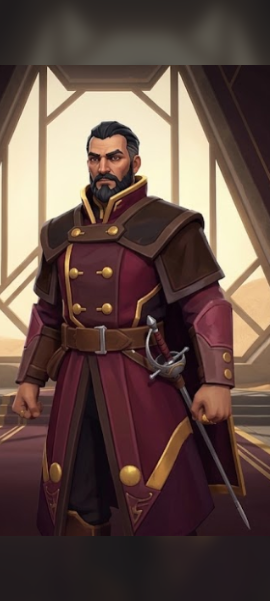
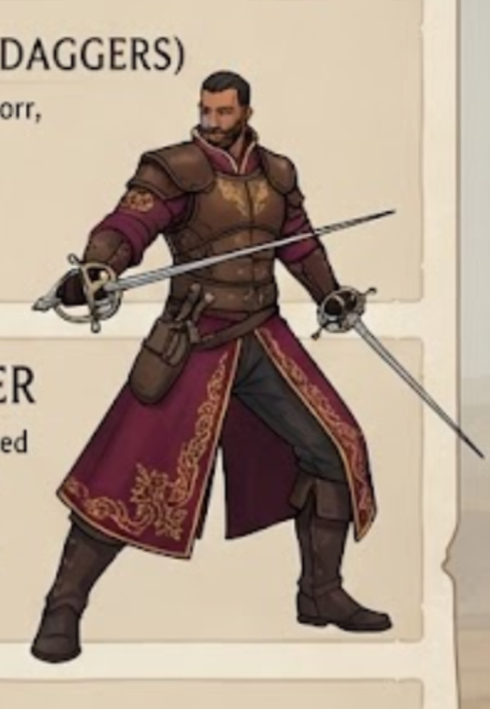
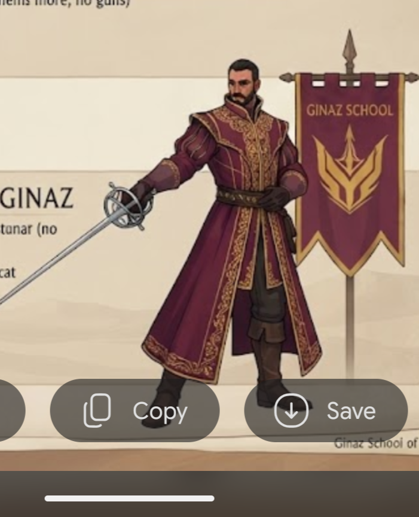
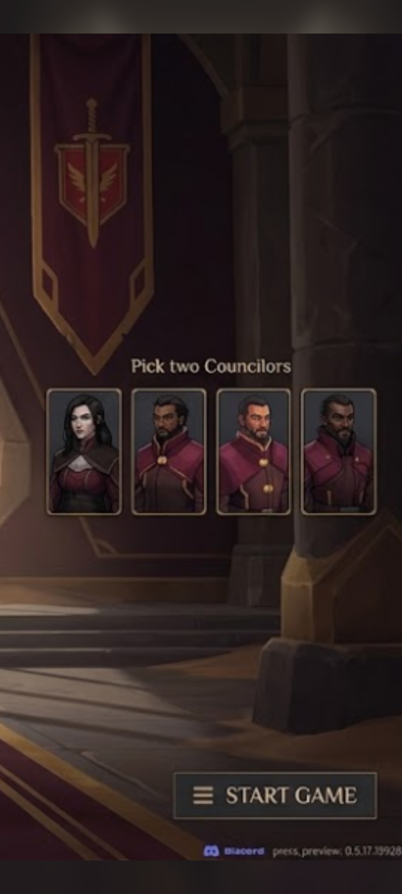

# Art direction

## Rule zero
Most concept images were made by an image-generation model. They are costume and mood reference, not a spec. When pictures disagree,
the decisions on this page win.

## Palette
Sampled from the original House Ginaz roster sheet and the swordmaster image, and used by our recolour script. RGB first, hex for UI.

| Role | RGB | Hex | Used for |
|---|---|---|---|
| Plum | 104, 54, 66 | `#683642` | armour plates, chest accents |
| Wine | 92, 32, 52 | `#5C2034` | the main coat, mantle (current build) |
| Dark wine | 52, 20, 32 | `#341420` | tunic body, shadows |
| Plum plate | 72, 42, 52 | `#482A34` | gloves, bracers |
| Plum dark | 42, 26, 33 | `#2A1A21` | trousers, under-suit |
| **Gold** | 196, 154, 78 | `#C49A4E` | trim, buttons, rims, embroidery, emblem |
| Leather | 70, 40, 34 | `#462822` | belts, boots, straps |
| Hair | 34, 27, 25 | `#221B19` | hair and beards (black) |
| Dark-brown leather (new, from the officer portrait) | about 70, 50, 40 | `#463228` | mantle/cuirass; to be added to the recolour palette |

UI backgrounds in the concept screens are near-black navy with gold borders and wine banners.

## Emblem rules
- **House emblem:** crossed rapiers over three waves, gold on wine. Pennant banner with a pointed end and a gold border.
- Use only the House emblem for the House. The **sword + winged shield** is the emblem of the earliest concept iteration (draft v3 screen and one councilor screen) and is superseded; the winged-trident crest is a possible school crest for elites/heroes.
- Faction-screen shield icon: crossed rapiers on a wine shield with a gold rim (draft v4), a small version of the banner emblem.
- On models, the emblem is a small embroidered patch (chest or collar), not a big print.

## Silhouette and shape language
- Long coat to the shin with a front split, **tall stand-up collar**, shoulders squared by a mantle or pauldrons, tall boots.
- A visible belt with a steel buckle; the rapier hangs at the hip or is drawn.
- Round gold buttons, gold piping, filigree on borders: the decoration is **linear** (borders and piping), not scattered.
- Hair is short or tied, black, with beards on men; no helmets.

## Costume tiers (derived from all the images)
| Tier | Look | Gold | Armour |
|---|---|---|---|
| Scout | short jacket, wide hat, shoulder strap | minimal | none |
| Trooper / Captain | long wine coat, collar, studs | buttons + rim | brown mantle or grey chest plate |
| Duelist / Throwers | wine coat + leather cuirass or bandoliers | embroidery on borders | leather cuirass, pauldrons |
| Elite Swordmaster / Master | full-body gold filigree, cape, banners | all borders and chest | little; cloth is the status |

**More gold embroidery = higher rank. Armour is leather and brown, never steel.**

## Corrections made to the AI images
| Problem | Decision |
|---|---|
| Banner emblem changes (crossed rapiers / sword + winged shield / winged trident) | House emblem = crossed rapiers over waves; the winged shield was the earliest iteration, the trident a possible school crest |
| "House Major" in the faction text | the game's term is **Great House** |
| Councilor Ran blue-black in one screen, wine in another | wine |
| "Adiutant Ran" typo | "Adjutant Ran" |
| Cassian/Corin ability text copied from Selene/Mei Ling | ignore; rewrite later (proposals in [leaders_and_councilors.md](leaders_and_councilors.md)) |
| Cassian looks different on two screens | choose one design before modelling (the grey-haired quilted-jacket Cassian is on the main select screen) |
| Three near-identical men on the unnamed councilor screen | use the portraits only for style; names come from the named screen |
| Inconsistent rapier hilts (ring, cup, swept) | keep our single Ecaz basket-hilt rapier |
| Garbled body text everywhere | transcribed once in the faction/leader docs; do not re-transcribe from the image |

## The reference images in detail
### Officer portrait (best match to our Captain)

Black slicked hair with a grey temple, beard; wine coat with a **double row of round gold buttons**, gold piping on the chest panel and collar,
tall collar with gold border; **dark-brown leather mantle** with a button strap across the chest; wine bracers with two gold buttons; brown forearm
guards; wide brown belt with steel buckle and pouch; hem with large gold discs and a small embroidered corner; dark trousers; tall boots; rapier on the left hip.

### Banner

Wine pennant, gold border, crossed rapiers over three waves.

### Duelist with two rapiers

Brown leather cuirass with gold embossed chest motif and pauldrons; wine sleeves with gold shoulder embroidery; long wine coat split at the front with filigree borders;
belt with pouches and dagger; dark trousers; tall boots; a rapier in each hand. Reference for the Elite Swordmaster and any dual-weapon role.

### Master with the School banner

Fully embroidered wine coat, tall collar, slashed puffed sleeves, gloves, long rapier with a ring guard; "GINAZ SCHOOL" banner with a gold winged trident. Reference for the Master and the Elite Swordmaster's richness.

### Swordmaster (main design reference)

Purple/wine long coat with gold braided edging, tall stand-up collar, a chest of horizontal braids with buttons, belt with a ring buckle, mantle plates on the shoulders,
leather bracers, tall boots, topknot and beard.

### Councilor pick screens

Portrait framing: bust, dark background, gold-bordered frame; useful when cropping the real portraits.

## Texture to-do list (maps to the Captain backlog)
1. Add "dark-brown leather" to the recolour palette; reclassify the mantle region.
2. Double gold button row on the chest/tunic UVs; gold piping on the coat front, collar and hem; hem discs.
3. Horizontal braiding across the chest (swordmaster reference).
4. Filigree borders (tier 3-4 units) as a tileable gold pattern painted along UV border strips.
5. Hair/beard: keep near-black; add a few grey strands at the temple for Grandmaster-age characters.
6. Make a small **emblem patch** texture (crossed rapiers and waves) for chest/collar/banner props.

## Do / don't
- Do keep wine as the dominant colour, gold as the accent, leather as the structure.
- Do put detail on borders and chest; keep the lower coat clean so animation reads.
- Don't use steel plate, helmets, shields, firearms or Sardaukar parts.
- Don't mix the emblems; don't use bright blue/green (the donor bodies' original scarf/coat colours must be fully recoloured).
