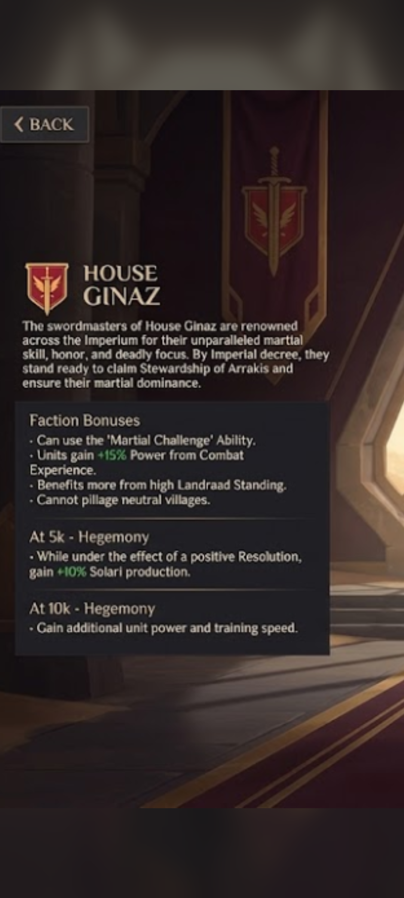
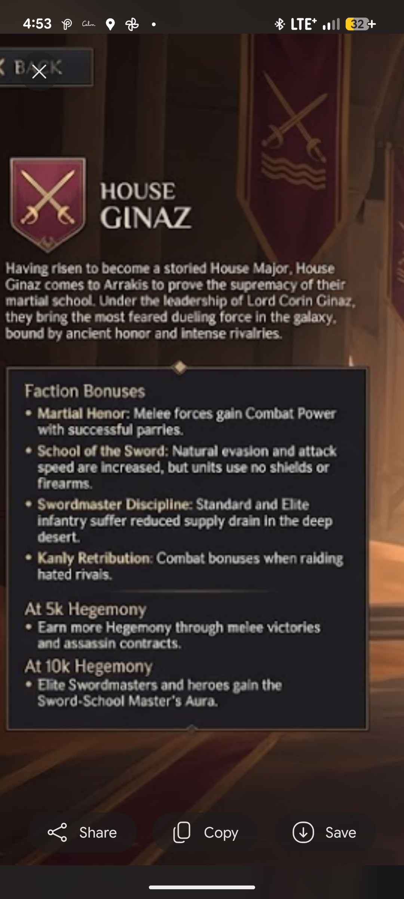
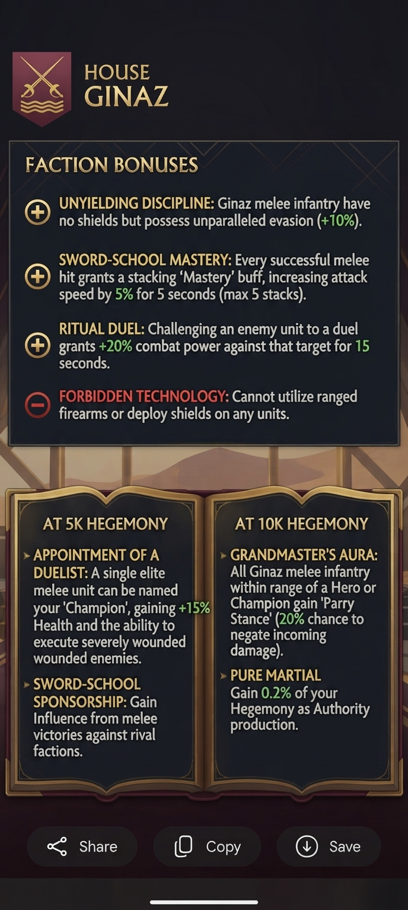

# Faction design: bonuses and milestones

The concept art contains two drafts of the House Ginaz faction-bonus screen. Both are recorded exactly, then reconciled into one
proposal. **All numbers are design values from concept images or proposals, not implemented in game data.**

## The four drafts at a glance
| Draft | Emblem | Style | Notes |
|---|---|---|---|
| **v3** (earliest) | sword + winged shield | short, in the game's own wording | uses bonuses that already exist in the game data (next section) |
| **v1** | crossed rapiers | ambitious, with numbers | duel, Mastery stacks, Champion, Forbidden Technology |
| **v2** | crossed rapiers | the most detailed, numeric | four core traits, two milestones |
| **v4** (latest) | crossed rapiers | in-game wording, no numbers | the short text of v2 as it would read on the faction screen |

The winged-shield emblem belongs to the earliest iteration (v3) and was replaced by the crossed rapiers; that explains the
"off-model" banner seen on one councilor screen.

## Draft v3: the earliest, and the closest to the real game

Blurb: "The swordmasters of House Ginaz are renowned across the Imperium for their unparalleled martial skill, honor, and deadly focus.
By Imperial decree, they stand ready to claim Stewardship of Arrakis and ensure their martial dominance."

**Faction bonuses**
- Can use the **Martial Challenge** ability (this is the Ritual Duel idea).
- Units gain **+15 % Power from Combat Experience**.
- **Benefits more from high Landsraad Standing.**
- **Cannot pillage neutral villages.**

**At 5K Hegemony:** while under the effect of a positive Resolution, gain +10 % Solari production.
**At 10K Hegemony:** gain additional unit power and training speed.

Why this draft matters: its wording copies real in-game attribute text. The game data has these exact attributes (checked 2026-10-24):
| v3 bonus | Existing attribute | Its description in the game |
|---|---|---|
| Cannot pillage neutral villages | `Pillage_NeutralVillage_Block` | "Cannot pillage neutral villages" |
| Benefits more from high Standing | `Standing_BetterHighTraits` | "Benefits more from a high [Standing]" |
| +15 % Power from Combat Experience | `Army_XPLevel_Effects_ARatio`, `Army_ExperienceGain_ARatio` | "[Experience] level effects", "[Experience] gains" |
| 5K: +10 % Solari under a positive Resolution | the Atreides 5K trait pattern `Resolution_Positive_GainTTrait` | "Gains ... while under the effect of a positive targeted Resolution" |
| 10K: unit power and training speed | `MilitaryUnits_TrainingSpeed_ARatio` (plus a power attribute) | "Military Units are trained % faster" |
| Martial Challenge | an `ability` entry (see roadmap) | not yet searched |

So **v3 could be built almost entirely from existing attributes**, whereas v1/v2 need evasion and parry, which the game does not have.

## Draft v4: the latest in-game wording

Blurb: "Having risen to become a storied House Major, House Ginaz comes to Arrakis to prove the supremacy of their martial school. Under the leadership of
Lord Corin Ginaz *(name under review, see [leaders_and_councilors.md](leaders_and_councilors.md))*, they bring the most feared dueling force in the galaxy,
bound by ancient honor and intense rivalries."
(The game's own term is **Great House**, not "House Major": "Great House" appears 54 times in the game data. Use that.)

- **Martial Honor:** melee forces gain Combat Power with successful parries.
- **School of the Sword:** natural evasion and attack speed are increased, but units use no shields or firearms.
- **Swordmaster Discipline:** Standard and Elite infantry suffer reduced supply drain in the deep desert.
- **Kanly Retribution:** combat bonuses when raiding hated rivals.
- **At 5K Hegemony:** earn more Hegemony through melee victories and assassin contracts.
- **At 10K Hegemony:** Elite Swordmasters and heroes gain the Sword-School Master's Aura.

This is the style the faction screen uses: one blurb, four short bonus lines, one line per milestone, no numbers. Numbers go in tooltips.

## Draft v2 (more detailed; the likelier final)

### Core traits
| Trait | Effect |
|---|---|
| **School of the Sword** | Base +20 % evasion. Melee infantry have no shields or firearms but fast, fluid movement (+10 % movement speed). |
| **Martial Honor** | 15 % parry chance (on hit). A successful parry negates all damage and builds a "Riposte" stack: +5 % attack speed, +5 % damage per stack, max 5 stacks (25 % global bonus). |
| **Swordmaster Discipline** | -20 % supply upkeep cost; footmen are resource-efficient (-50 % supply drain in the Deep Desert). |
| **Kanly Retribution** | +30 % melee damage against declared Rivals: all units fight harder when fighting or raiding inside the territory of factions with an active Kanly against House Ginaz. |

### Hegemony milestones
| Hegemony | Bonus |
|---|---|
| **5K** | **Master Dueling:** +5 hegemony per enemy unit killed in melee. **Assassin Contracts:** +200 hegemony for completing any "Kill" or "Harass" operation. |
| **10K** | **Sword-School Master's Aura:** all Elite units and Heroes project a 10 m combat aura; friendly infantry inside gain +10 % evasion and +10 % parry chance (stacks). |

## Draft v1 (earlier)

- **Unyielding Discipline:** melee infantry have no shields but unparalleled evasion (+10 %).
- **Sword-School Mastery:** every successful melee hit grants a stacking "Mastery" buff, +5 % attack speed for 5 s (max 5 stacks).
- **Ritual Duel:** challenging an enemy unit to a duel grants +20 % combat power against that target for 15 s.
- **Forbidden Technology (drawback):** cannot use ranged firearms or deploy shields on any unit.
- **5K, Appointment of a Duelist:** one elite melee unit can be named "Champion": +15 % health and can execute severely wounded enemies.
  **Sword-School Sponsorship:** gain Influence from melee victories against rival factions.
- **10K, Grandmaster's Aura:** melee infantry within range of a Hero or Champion gain "Parry Stance" (20 % chance to negate incoming damage).
  **Pure Martial:** gain 0.2 % of your Hegemony as Authority production.

## What each draft contributes
| Idea | v1 | v2 | Keep? |
|---|---|---|---|
| Evasion as the identity | +10 % | +20 % base (+10 % movement) | yes, v2 values as the starting point |
| Parry | only via 10K aura (20 %) | core trait 15 % on hit | yes (core) |
| Stacking buff | Mastery: +5 % AS per hit, 5 s, 5 stacks | Riposte: +5 % AS and +5 % damage per parry, 5 stacks | merge: stacks fed by parry **and** hit (see below) |
| Duel mechanic | Ritual Duel faction ability | moved to Councilor Jool as an active | keep as Councilor/Hero active, not a faction passive |
| Champion | 5K milestone | dropped | **bring back**: gives the player a named unit and a unit to build; Ecaz already has a Champion system in the game data to copy |
| Drawback | "Forbidden Technology" explicit | folded into School of the Sword text | keep the explicit drawback: it is what makes the bonuses fair |
| Supply | not present | -20 % upkeep, -50 % Deep Desert drain | keep (desert flavour) |
| Kanly | not present | +30 % melee damage vs Rivals | keep, but see balance notes |
| Hegemony economy | Authority from Hegemony | Hegemony from kills/contracts | keep v2 (fits "honour as a resource") |
| Combat Experience power | not present | not present | add from v3 (+15 %): rewards surviving duellists; exact attribute exists |
| High Standing bonus | not present | not present | add from v3: ties to Landsraad play; exact attribute exists |
| Neutral-village pillage ban | not present | not present | add from v3 as an honour drawback; exact attribute exists |
| 5K Solari under a positive Resolution | not present | not present | optional; it is the Atreides pattern so it is trivial to build, but not "duelist" flavour |

## Two tiers: what can be built now vs later
| Tier | Content | Why |
|---|---|---|
| **Tier 1, buildable now** | v3 bonuses (Combat Experience power, high Standing, no neutral pillaging, 5K Solari under a positive Resolution, 10K unit power and training speed), plus attack speed, movement speed, supply drain/upkeep, ignore-armour, execute (Champion) | all have matching attributes in the game data |
| **Tier 2, needs a workaround** | evasion, parry/riposte, duel disable, Kanly-rival condition, 10 m aura | no direct attribute; approximate (armour/damage reduction) or test an ability |

Plan: ship Tier 1 first so the House feels different immediately, then add Tier 2 approximations. See [implementation_roadmap.md](implementation_roadmap.md).

## Reconciled proposal (working canon)
The following is a suggestion made by merging both drafts; it is meant to be edited by the user.

**In-game text (v4 style, proposed)**
> House Ginaz: a Great House whose swordmasters are renowned across the Imperium for martial skill, honor and deadly focus. By Imperial decree they stand ready to claim Stewardship of Arrakis.
> - *School of the Sword:* evasion and attack speed are increased, but units use no shields or firearms.
> - *Martial Honor:* melee forces gain Combat Power with successful parries and from Combat Experience.
> - *Swordmaster Discipline:* Standard and Elite infantry suffer reduced supply drain in the deep desert.
> - *Kanly Retribution:* combat bonuses when raiding hated rivals. Cannot pillage neutral villages.
> - **5K Hegemony:** earn more Hegemony through melee victories and assassin contracts.
> - **10K Hegemony:** Elite Swordmasters and heroes project the Sword-School Master's Aura.

**Starting traits (always on)**
1. **School of the Sword:** +20 % evasion, +10 % movement speed for melee infantry. *Cannot field shields or firearms.* (the explicit drawback)
2. **Martial Honor:** 15 % parry on hit; a parry negates the hit and gives a **Riposte** stack (+5 % attack speed, +5 % damage, max 5).
3. **Swordmaster Discipline:** -20 % supply upkeep; -50 % supply drain in the Deep Desert.
4. **Kanly Retribution:** +30 % melee damage vs declared Rivals (fighting or raiding in their territory).

**5K hegemony:** Master Dueling (+5 hegemony per melee kill) and **Appointment of a Duelist** (name one Elite melee unit Champion:
+15 % health, can execute badly wounded enemies). Assassin Contracts (+200 hegemony per Kill/Harass operation) stays.

**10K hegemony:** Sword-School Master's Aura (10 m aura from Elites, Heroes and the Champion; +10 % evasion, +10 % parry for friendly infantry,
stacking) and Pure Martial (0.2 % of Hegemony as Authority) if the economy needs a late-game kicker.

## Balance notes and questions
- **Evasion and parry stack with the aura:** 20 % + 10 % evasion and 15 % + 10 % parry on a unit in the aura is a large effective health
  multiplier (roughly 40-50 % of hits avoided before armour). Because the House has no shields and no ranged answer, that may be exactly
  right, but it needs a playtest; consider capping total avoidance (for example at 50 %).
- **Riposte stacks** use "on parry" in v2 but "on hit" in v1; with 15 % parry chance, stacks build slowly. Feeding stacks from hits too
  (Mastery) makes the buff reliable. Decide which.
- **Kanly Retribution +30 %** only triggers in rival territory, which makes the House strong when attacking and weaker when defending its own
  land. Is that intended? If not, extend it to fights vs the Rival anywhere.
- **Supply:** -20 % upkeep plus -50 % desert drain is strong on large maps; check against the desert-heavy Fremen/Harkonnen play.
- **Hegemony from kills:** +5 per melee kill is faster than most sources early; scale with unit tier if it snowballs.
- **No ranged anything:** make sure Throwers (thrown daggers) are consistent with "no firearms" (they are not firearms but they are
  ranged; the concept roster includes them, so say so explicitly in the rules).
- **AI:** the game's AI plays factions through weights; a faction with no ranged/shield units needs its AI weights checked or it will stall.

## Faction actions to design
| Action | Source | Idea |
|---|---|---|
| Declare Kanly | Kanly Retribution, Council Jool/Aya | choose a rival; unlock the +30 % bonus vs them; a truce timer (Jool halves it) |
| Name Champion | 5K milestone | pick one Elite unit; permanent buff |
| Ritual Duel | v1 faction ability, Jool active | challenge one enemy unit: +20 % power vs it for 15 s, its special abilities disabled for 5 s |
| Assassin Contract | 5K milestone | operations "Kill"/"Harass" pay 200 hegemony |
