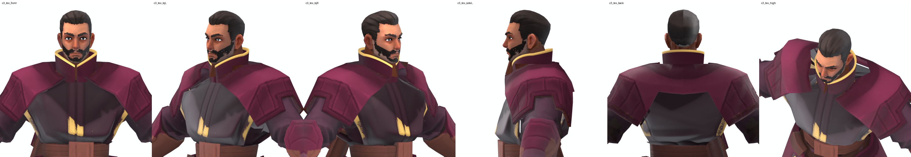
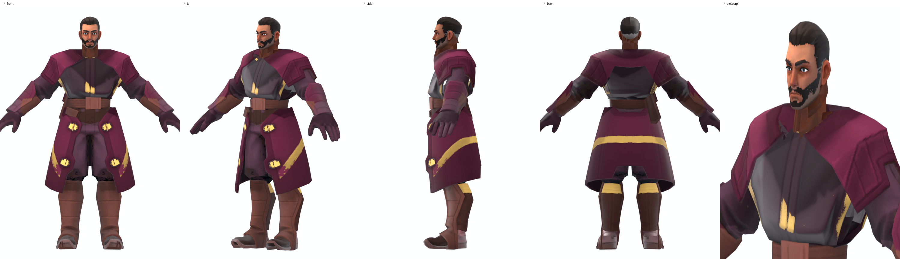
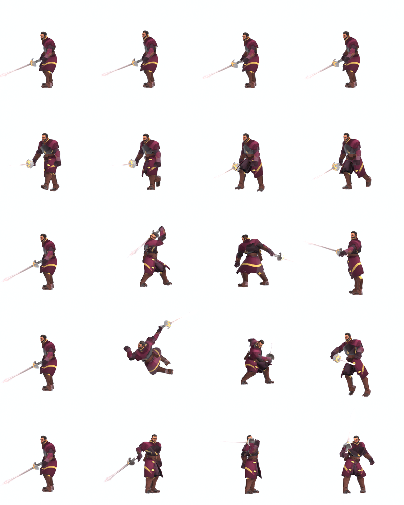
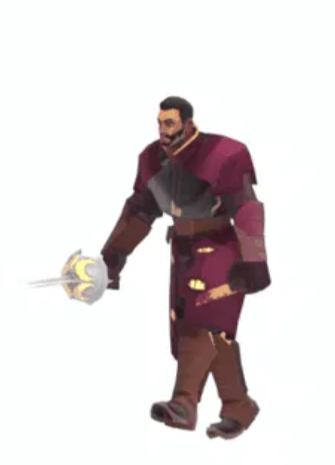
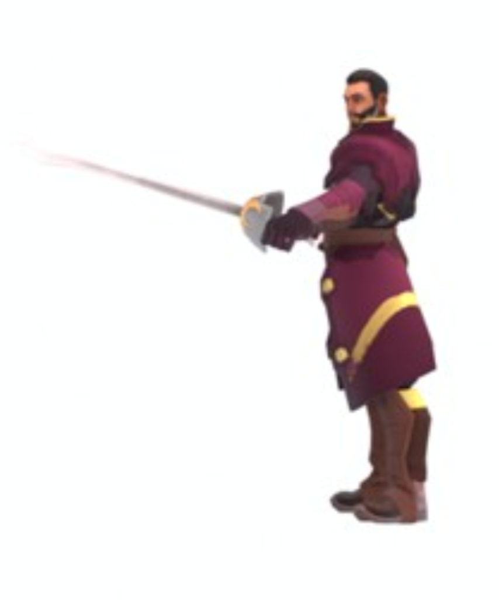

# The Ginaz Captain (built and in the game)

The first House Ginaz unit: a duelist officer in a long wine coat with a tall gold-rimmed stand-up collar, black hair and beard, and a
tall rapier. In the concept roster it corresponds to the **Troopers**. Built 2026-10-23/24, installed 2026-10-24, confirmed working in game by the user.

Frames from the animation previews (low resolution crops): a walk with the rapier held at the hip, and a lunge.

Animation GIFs (idle, run, attack 1, attack 2, skill): `model_projects/kitbash_explore/02_progress_photos/07_sword/gifs/` and
`.claude/skills/dsw-new-unit/examples/ginaz_captain/gifs/`.

## What it is made of (kitbash)
| Piece | Source | Treatment |
|---|---|---|
| Body (mantle, sleeves, belt, trousers, boots) | Smuggler **Mercenary** | removed 16 islands (blue scarf/cape pieces, pouches, holster, baked sword/scabbard) and every mostly-metal island |
| Chest | **Raider** tunic islands | torso fill, clipped under the mantle, skin weights copied from the uncut Mercenary |
| Coat tails | **Gurney** islands 9, 10, 22, 23 | recoloured wine with gold studs and stripe |
| Head | **Bannerjee** | hair and beard recoloured near-black, neck tube kept, nape stitched |
| Collar | **hand-modelled** | wine body with a gold rim, tallest at the back, hairline seam at the front |
| Weapon | Ecaz **TallSword** (the Fencer's rapier) | baked into the mesh, skinned to the weapon bone, vanilla textures |
| Colours | House Ginaz palette | recoloured per body region |

Why this body: it removes the Mercenary's metal and scarf (the user's "no scarf" and "remove metal" asks) while keeping the leather mantle; the Raider
tunic gives a fabric chest, which the user preferred over a bare chest.

## In game
| Item | Value |
|---|---|
| Unit / model id | `A_Elite` (the Atreides **Warden** slot, taken over) |
| Name | Ginaz Captain / Ginaz Captains |
| Squad | 5 (was 4) |
| Start of game | one squad of 5 spawns beside Arrakeen (`structure.Arrakeen.startUnits`) with the existing Ornithopter and the Landsraad guard |
| Stats | unchanged Warden: 500 health, 16 power, 8 armor |
| Cost / upkeep | 100 Solari + 50 Manpower; upkeep 20 Solari + 5 Command Points |
| Animations | `MilitaryCommon` set (idle, run, melee attacks, hit, death); rig `Male01` (`rigName` 0); scale 1.1 |
| Sounds | `Play_Common_Move`, `Common_Death`, `Voice_A_Trooper_*` (was shield move, female death, Warden voices) |
| Model files | `CharMOD/Male01_GinazCaptain/`: 1 mesh, 6 materials, ~7.3k tris, 53 joints (Male01 plus 7 whip joints, same as the vanilla Mercenary) |

Side effect: **every Warden the Atreides recruit is now a Ginaz Captain** (that is what taking over the slot means). Other custom units
(the Landsraad guard) were not touched.

## Preview checks done
- 6 angles textured and flat-colour per object; back-face-culled view; close-up strips of the shoulders and neck.
- Real clips: run, 3 melee attacks, hit reaction (sword in hand throughout), plus Duncan's swordmaster set.
- Known leftover: in a hard cross-chest arm swing the tunic folds under the left armpit; the vanilla Mercenary hides the same spot under its scarf.

## Test checklist (in game)
- [ ] `game.log` has `[DataCache] Modified data.cdb` (it did on the first launch)
- [ ] 5 captains stand beside Arrakeen at game start
- [ ] size looks right next to a Trooper (scale 1.1)
- [ ] textures: wine coat, gold collar rim, black hair; nothing black/grey/washed
- [ ] sword stays in the hand when idle, running, attacking and being hit
- [ ] recruiting a Warden from the wheel gives the same unit, name and icon text
- [ ] voices/sounds are male trooper ones
- [ ] the original Landsraad guard still spawns and works

## Upgrade backlog (from the officer portrait and the main reference)
Compare `images/art_officer_portrait.png` and `images/swordmaster_reference.jpg` with the build:
| Upgrade | Now | Target | How |
|---|---|---|---|
| Mantle colour | wine | **dark-brown leather** | recolour rule for the Mercenary mantle (`09_ginaz_recolour.py` RULES) |
| Chest buttons | none | double row of round gold buttons on the chest panel | paint gold circles into the Raider tunic region of its texture |
| Gold piping | rim only on the collar | piping down the coat front and along the collar and hem | texture paint on the Gurney coat/tunic UVs |
| Hem discs | studs | two large gold discs plus an embroidered corner | texture paint |
| Braided chest | none | horizontal gold braids (swordmaster reference) | texture paint |
| Coat length | knee | mid-shin | scale/extend the Gurney panels |
| Belt gear | front pouch + back holster remain | removed | island removal in the recipe |
| Bracers | leather | wine with two gold buttons | recolour + paint |
Everything above is texture or small mesh work; none of it touches the skeleton, so the unit and its data entries stay valid.

## How to change it (workflow)
1. Edit the recipe/recolour in `model_projects/kitbash_explore/08_scripts/` (see the `dsw-new-unit` skill).
2. Re-export (`12_assemble_export.py`), re-convert (`convert_model.py ...`), re-copy textures, `repackage.py`.
3. The data entries do not need to change unless the animation set, scale or squad changes.

## Revert
- Data: `model_projects/kitbash_explore/07_data_cdb/data_BEFORE_ginaz_captain.cdb` (also under `mod_files/backups/`).
- Pak: `pak_archive/res.compressed1_20261024_143757.pak`.
- Details: `model_projects/kitbash_explore/SPEC.md`.

## Polish pass 2026-10-25
The Captain was rebuilt with real gold buttons (three pairs) and a rolled gold collar rim (metallic material), x2 textures, gold piping down the chest panel and along the coat opening and
hem, cleaned donor trim, twill weave and detail normals.  The upgraded files are STAGED (editor resource tree + `model_projects/ginaz_polish/06_game_ready/Male01_GinazCaptain`), NOT yet in the live game:
the version in the game is still the earlier one.  Install: `repackage.py --quiet --no-launch`; roll back from `model_projects/ginaz_polish/06_game_ready/_previous_installed/`.
