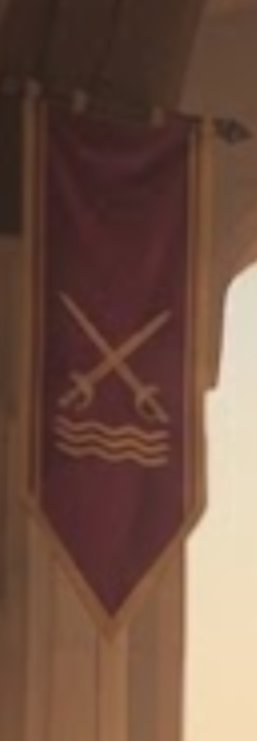
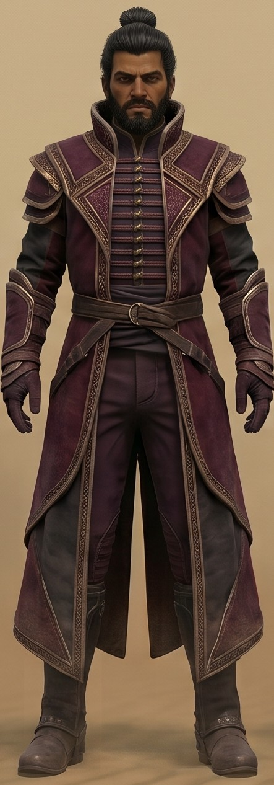
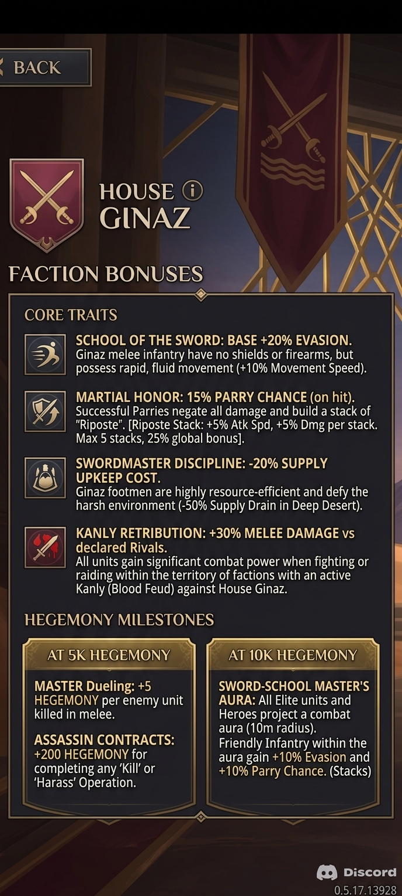
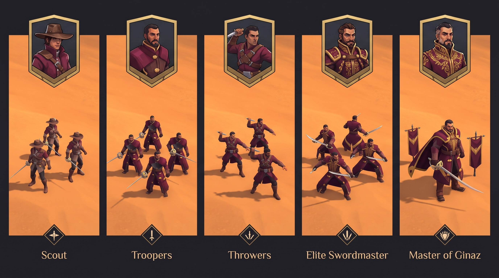

# House Ginaz

*A custom House for Dune: Spice Wars: duellists in long wine-red coats who reject shields and firearms and win by evasion, parries and ritual combat.*

This is the one-page overview. The detail lives in the other files (index in [README.md](README.md)).

## At a glance
| | |
|---|---|
| **Emblem** | crossed rapiers over three waves, gold on wine |
| **Colours** | wine / plum coats, gold trim, dark-brown leather, black hair |
| **Weapons** | rapier (sabre for elites), throwing daggers; **no shields, no firearms** |
| **Playstyle** | small elite melee squads; evasion and parry; stacking buffs; supply-efficient; honour (Kanly, duels) as a resource |
| **Leader choice** | Grandmasters: Cassian Vos, Lord Corin Ginaz, Selene Zohar, Mei Ling |
| **Councilors (pick two)** | Master Chirox, Commander Jool, Lady Aya, Adjutant Ran |
| **Units** | Scout, Troopers, Throwers, Elite Swordmaster, Master of Ginaz |
| **In the game today** | the **Ginaz Captain** (the Troopers' look), over the Atreides Warden slot, squad 5, one squad spawned at game start |

## Where to read more
| Topic | File |
|---|---|
| Symbols, tone, vocabulary, playstyle pillars, weaknesses, open lore questions | [identity_and_lore.md](identity_and_lore.md) |
| Faction bonuses (two drafts), reconciled proposal, balance notes, faction actions | [faction_design.md](faction_design.md) |
| Grandmasters, abilities, proposed kits for Cassian and Corin, Councilors, synergies | [leaders_and_councilors.md](leaders_and_councilors.md) |
| The five unit lines: role, look, donor models, stat sketch, build order | [units.md](units.md) |
| The built Captain: recipe, in-game values, checklist, upgrade backlog, revert | [ginaz_captain.md](ginaz_captain.md) |
| Palette (hex), emblem rules, costume tiers, AI-art corrections, texture to-do | [art_direction.md](art_direction.md) |
| Game data facts, per-bonus attribute mapping, gaps, three integration paths, phases | [implementation_roadmap.md](implementation_roadmap.md) |
| Every image and whether it is canon | [image_index.md](image_index.md) |

## Concept screens (quick look)

## Current status and next steps
- **Done:** the Captain is built, installed and confirmed working; design documents cover identity, faction, leaders, units, art and the game-data plan.
- **Next (suggested):** Captain texture upgrades from the officer portrait (brown mantle, gold buttons/piping/hem discs); then Elite Swordmaster and Master of Ginaz;
  then a testbed of the faction traits (see [implementation_roadmap.md](implementation_roadmap.md)).
- **Decisions needed from the user:** full faction or units only (the screens say "Great House", which suggests a full faction); a new name for **Lord Corin Ginaz** (candidates in
  [leaders_and_councilors.md](leaders_and_councilors.md): Severin, Evander, Tavian, Marek, Dorian, Aurelian); which Grandmaster design is canon (Cassian has two looks);
  whether the Captain stays in the Warden slot; the Cassian and leader ability kits (proposals in the same file); and whether to start with the "buildable now" bonus set (see [faction_design.md](faction_design.md)).

## Design rules we follow
- No shields, no firearms on Ginaz units; duellists in coats with rapiers.
- Never use Sardaukar parts for new units (standing rule from the user).
- New units are made by kitbashing game models, removing parts (backpacks, belts, scarves, metal plates) so they are not simply blends,
  hand-modelling what is missing, recolouring to the House palette, then installing. The process is saved as the `dsw-new-unit` skill
  (`.claude/skills/dsw-new-unit/`).
- Concept images are AI-generated reference, not spec; the canon decisions are in [art_direction.md](art_direction.md).
