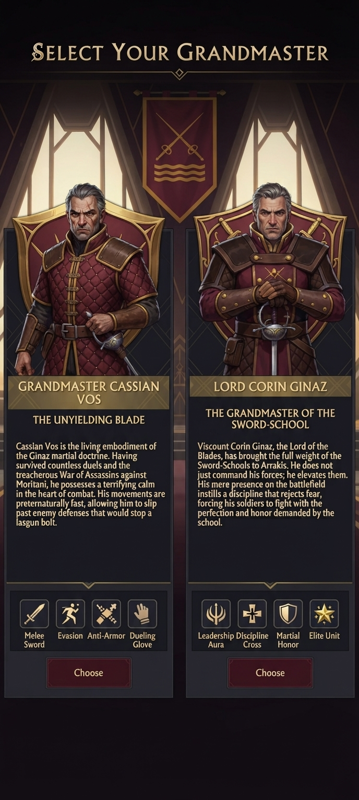
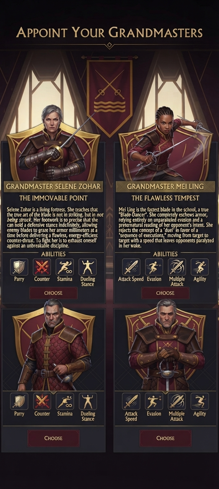
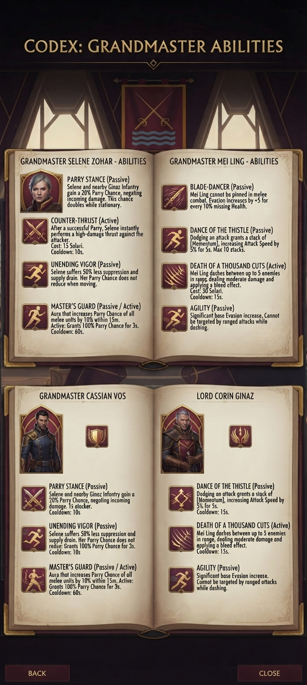
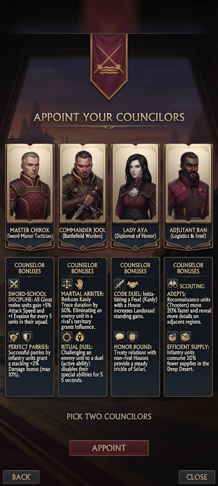

# Leaders and Councilors

How the game structures a faction (checked in `data.cdb`): one **leader** character, four **councilors** (each with a passive trait),
and a speaker. The concept art fits this: Grandmasters are the leader choice, Councilors are the four pick-two advisers.
(Vanilla Atreides: leader Leto; councilors Thufir, Yueh, Jessica, Paul.) The image model garbled some text, so unfinished parts are
marked, and abilities I have proposed myself are labelled **PROPOSED**.

## Name under review: "Lord Corin Ginaz"
The user flagged **Corin** as a poor name: it sounds like **Corrino** (the Imperial House, a faction in the game) and there is a planet called **Corrin**
(the game data mentions "Corrin" 507 times, mostly Corrino). It is also the name in the faction-screen blurb ("Under the leadership of Lord Corin Ginaz").
I have **not** renamed him yet so the transcriptions stay faithful to the images; the name appears in several files and in the portrait art. Candidates,
checked against the 54 character first names in the game data (none clashes) and chosen to avoid a "Cor-" sound:

| Candidate | Feel |
|---|---|
| Lord **Severin** Ginaz | stern, easy to say; my recommendation |
| Lord **Evander** Ginaz | noble, martial, classical |
| Lord **Tavian** Ginaz | sharp, short, unusual |
| Lord **Marek** Ginaz | blunt soldier's name |
| Lord **Dorian** Ginaz | elegant, duelist-like |
| Lord **Aurelian** Ginaz | grand, imperial; maybe too close to the Corrino feel |

Once one is chosen, replace "Corin" in: this file, `README.md`, `house_description.md`, `faction_design.md` (v4 blurb), `image_index.md`, `identity_and_lore.md`.

## Grandmasters (leader / hero)

Logical order of the three concept screens: select, appoint, codex.

### 1. Select Your Grandmaster

| Grandmaster | Title | Lore | Tags |
|---|---|---|---|
| **Cassian Vos** | The Unyielding Blade | Living embodiment of the Ginaz martial doctrine; survived countless duels and the treacherous War of Assassins against Moritani; terrifying calm in combat; preternaturally fast, slips past defences that would stop a lasgun bolt. | Melee Sword, Evasion, Anti-Armor, Dueling Glove |
| **Lord Corin Ginaz** | The Grandmaster of the Sword-School | Viscount Corin Ginaz, Lord of the Blades, brought the full weight of the Sword-Schools to Arrakis. He elevates his forces: his presence instills a discipline that rejects fear and demands perfection and honour. | Leadership Aura, Discipline Cross, Martial Honor, Elite Unit |

### 2. Appoint Your Grandmasters

| Grandmaster | Title | Lore | Ability icons |
|---|---|---|---|
| **Selene Zohar** | The Immovable Point | A living fortress. The art of the blade is not striking but *not being struck*; she holds a defensive stance indefinitely, lets blades graze her armour millimetres at a time, then delivers one flawless, energy-efficient counter-thrust. Fighting her exhausts the attacker against unbreakable discipline. | Parry, Counter, Stamina, Dueling Stance |
| **Mei Ling** | The Flawless Tempest | The fastest blade in the school, a "Blade-Dancer". Wears no armour, relies on evasion and a preternatural reading of her opponent's intent. Rejects the duel in favour of a "sequence of executions", moving target to target at a speed that leaves opponents paralysed in her wake. | Attack Speed, Evasion, Multiple Attack, Agility |

Looks: Selene, grey short hair, dark leather armour and heavy gauntlets, rapier; Mei Ling, dark skin, braids, light armour, two rapiers mid-spin.
The two unnamed lower cards reuse these icon rows and show the Cassian/Corin portraits: unfinished placeholders.

### 3. Codex: abilities

**Selene Zohar: the fortress (defence, parry, support)**
| Ability | Type | Effect |
|---|---|---|
| Parry Stance | Passive | Selene and nearby Ginaz infantry gain 20 % Parry Chance (negate incoming damage); doubles while stationary. |
| Counter-Thrust | Active | After a successful Parry, instantly performs a high-damage thrust at the attacker. 15 Solari, 10 s cooldown. |
| Unending Vigor | Passive | 50 % less suppression and supply drain; Parry Chance does not reduce when moving. |
| Master's Guard | Passive / Active | Aura: +10 % Parry Chance for all melee units within 15 m. Active: 100 % Parry Chance for 3 s. 60 s cooldown. |

**Mei Ling: the tempest (evasion, speed, assassination)**
| Ability | Type | Effect |
|---|---|---|
| Blade-Dancer | Passive | Cannot be pinned in melee combat. Evasion +5 for every 10 % missing Health. |
| Dance of the Thistle | Passive | Dodging an attack grants a [Momentum] stack: +5 % Attack Speed for 5 s, max 10 stacks. |
| Death of a Thousand Cuts | Active | Dashes between up to 5 enemies in range, moderate damage plus a bleed. 30 Solari, 15 s cooldown. |
| Agility | Passive | Significant base Evasion increase; cannot be targeted by ranged attacks while dashing. |

**Cassian Vos and Lord Corin Ginaz:** their codex pages are near copies of Selene's and Mei Ling's (the Cassian page still says "Selene", the Corin
page still says "Mei Ling"). Cassian's codex portrait is also a different man (young, dark hair, navy coat) from the grey-haired Cassian on the
selection screen. Their abilities are **not designed yet**; proposals follow.

### PROPOSED kits for Cassian and Corin (to be edited by the user)
Written to fit their tags and to differ from Selene (parry-defence) and Mei Ling (evasion-speed).

**Cassian Vos, The Unyielding Blade (tags: Melee Sword, Evasion, Anti-Armor, Dueling Glove)** an anti-armour duellist and champion-killer.
| Ability | Type | Proposed effect |
|---|---|---|
| Calm in the Storm | Passive | Immune to suppression while in melee; +10 % evasion. |
| Armour-Piercing Thrust | Passive | His attacks ignore 30 % of target armour (the "anti-armour" tag; "slips past defences"). |
| Dueling Glove | Active | Challenge one enemy unit: for 15 s he deals +20 % damage to it, and its special abilities are disabled for 5 s (this is the faction's Ritual Duel, given to the unit with the glove). 25 Solari, 30 s cooldown. |
| Lasgun-Slip | Passive | Takes 50 % less damage from ranged attacks while moving (the "lasgun bolt" line). |

**Lord Corin Ginaz, Grandmaster of the Sword-School (tags: Leadership Aura, Discipline Cross, Martial Honor, Elite Unit)** a leader who
multiplies the whole army; an Elite unit himself.
| Ability | Type | Proposed effect |
|---|---|---|
| Leadership Aura | Passive | 15 m aura: friendly infantry +5 % attack speed and +5 % damage. |
| Discipline Cross | Passive | Aura: allies cannot rout; they fight on at low health with +10 % armour below 30 % health. |
| Martial Honor | Passive | Each successful parry by any unit in the aura adds a Riposte stack to that unit (the faction trait, strengthened). |
| Name the Champion | Active | Once per game: designate an Elite unit as Champion (+15 % health, execute); free, 60 s cast. Ties to the 5K milestone. |

## Councilors (pick two)

Concept screens with the full ability text, and a second pick screen with names. Names corrected: "Adjutant Ran" (the screen misspells it).

| Councilor | Role | Look | Bonuses |
|---|---|---|---|
| **Master Chirox** | Sword Master Tactician | grey hair, quilted wine armour, gold-brown shoulder | **Sword-School Discipline:** all melee units gain +5 % attack speed and +1 evasion per 5 units in their squad. **Perfect Parries:** successful infantry parries grant a stacking +2 % damage (max 10 %). |
| **Commander Jool** | Battlefield Warden | dark hair and beard, wine scarf, steel pauldron | **Martial Arbiter:** reduces Kanly truce duration by 50 %; eliminating an enemy in a rival's territory grants Influence. **Ritual Duel:** active, challenge an enemy unit, disables its specials for 5 s. |
| **Lady Aya** | Diplomat of Honor | black hair, hooded, wine | **Code Duel:** starting a Feud (Kanly) with a House increases Landsraad standing gains. **Honor Bound:** treaties with non-rival Houses give a steady trickle of Solari. |
| **Adjutant Ran** | Logistics and Intel | dark skin, short beard, wine coat (the screen also shows navy; wine is canon) | **Scouting Adepts:** reconnaissance units (Thoopters) move 20 % faster and reveal more of adjacent regions. **Efficient Supply:** infantry use 20 % fewer supplies in the Deep Desert. |

Note: Adjutant Ran's portrait is the closest to our Ginaz Captain look.

## Synergy map (what combines with what)
| Combination | Effect |
|---|---|
| Selene + Chirox | parry-everything doom ball: parry stacks, squad-size evasion, parry aura. Strongest defence; low offence. |
| Mei Ling + Chirox | speed stacks (Momentum + attack speed per squad); fast, fragile. |
| Cassian + Jool | duel specialists: anti-armour duels plus truce reduction; best against heavy units. |
| Corin + any | amplifier; strongest with many Elites and a named Champion. |
| Aya + Ran | economy/diplomacy; weakest in combat, best long game (Solari, supply, scouting). |
| Jool + Aya | Kanly engine: feuds are cheaper to run and pay Influence plus standing. |

## Open decisions
- Does the player pick **one** Grandmaster (leader) and **two** Councilors? The screens suggest yes.
- Are Selene and Mei Ling Grandmasters (leader options) or hero units once on the map? The concept shows both.
- Female Grandmasters need Female01 body models (the Warden/Ranger/Free Company bodies exist, see [units.md](units.md)).
- Portraits: the game uses a leader banner image and a councilor strip image; the AI portraits here would need cropping to those formats.
- Rewrite the garbled Cassian/Corin codex pages from the proposals above once the user approves.
