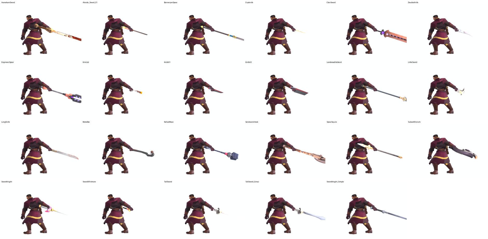
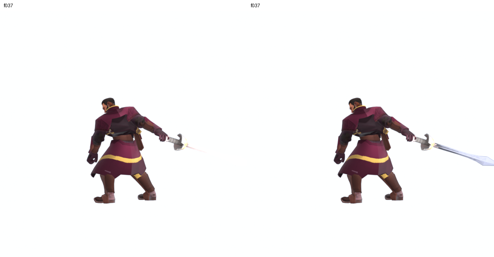
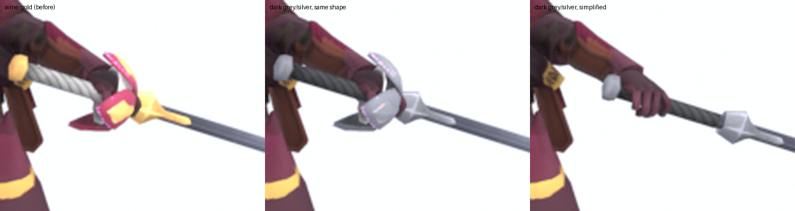

# Unit specs: every House Ginaz unit

One page per question: *what units exist, what do they carry, how do they fight, what are their numbers, and where are they in the game.*
Design intent (looks, donor models, build order) stays in [units.md](units.md); the Captain's full build record is in [ginaz_captain.md](ginaz_captain.md).

In-game numbers below were read from `mod_files/data.cdb` on 2026-10-25 (the `G_*` rows of the `Ginaz` faction, added by
`model_projects/ginaz_faction/08_scripts/16_add_ginaz_faction.py`). The data is installed, but **nobody has launched the game with it yet**, so every row is "unverified in game".

## The roster at a glance
| Unit | Data id | Model | Squad | Health / Power / Armor | Weapon | Status |
|---|---|---|---|---|---|---|
| **Ginaz Captain** | `G_Elite` | `Male01_GinazCaptain`, scale 1.1 | 5 | 500 / 16 / 8 | tall rapier | in data, in pak; model polished |
| **Ginaz Swordmaster** | `G_Trooper` | the **Captain's model**, scale 1.05 | 5 (inherited) | 500 / 14 / 6 | tall rapier | in data; no model of its own yet |
| **Ginaz Neophyte** | `G_GinazNeophyte` | `Male01_GinazNeophyte`, scale 1.0 | 5 | 250 / 8 / 2 | none (unarmed) | in data |
| **Master of Ginaz** | `G_GinazMaster` | `Male01_GinazMaster`, scale 1.15 | 1 (hero) | 900 / 28 / 6 | tall rapier | in data; no hero ability yet |
| Scout | none | none | 3 (concept) | sketch 200 / 8 / 1 | rapier | **not built** (needs a hat) |
| Throwers | none | none | 3 (concept) | sketch 220 / 12 / 1 | throwing daggers | **not built** (needs a projectile setup) |
| Elite Swordmaster | none | none | 4 (concept) | sketch 450 / 18 / 4 | curved sabre or dual rapiers | **not built** (`DualSwords` anim set exists) |

Concept lines vs built units: the five-line concept render ([units.md](units.md)) and the six-figure roster sheet disagree on names. Mapping we use:
Troopers = Ginaz Swordmaster (`G_Trooper`), the Captain = the elite slot (`G_Elite`), Master = Master, Neophyte = roster sheet only; the concept's Elite Swordmaster is not built.

## Costs and wheel positions (from the data)
| Unit | Recruit | Upkeep | Wheel |
|---|---|---|---|
| Captain | 100 Solari + 50 Manpower | 20 Solari + 5 Command Points | Elite default (group 1, pos 3) |
| Swordmaster | 50 Manpower | 10 Solari + 5 Command Points | group 1, pos 4 |
| Neophyte | 50 Manpower | 10 Solari + 5 Command Points | group 1, pos 5 (the old Atreides Ranger slot; vanilla's wheel only has group 1 positions 0 to 9) |
| Master | none set | none set | group 0, pos 0 (hero slot is unverified) |

The faction starts with `GinazKeep.startUnits = G_Ornithopter, G_Trooper, G_Elite` (an ornithopter, a squad of Swordmasters and a squad of Captains).

**Headquarters:** the **Ginaz Sword-School** (`GinazKeep`, region `GinazBase`; it was "Ginaz Enclave" until 2026-10-25). "Sword-School" is the House's own word for its institution ([identity_and_lore.md](identity_and_lore.md)).

**Roster fix, 2026-10-25** (`model_projects/ginaz_faction/08_scripts/18_fix_ginaz_roster.py`): removed the Landsraad Elite, which does not belong to House Ginaz; replaced the Atreides Ranger (a rifle unit) with the Neophyte; renamed the HQ. Everything else is as before.

## Weapons
| Unit | Weapon | How it is attached |
|---|---|---|
| Captain, Swordmaster, Master | Ecaz **TallSword** (the Fencer's long basket-hilt rapier), vanilla textures | **baked into the mesh**, skinned to the weapon bone `B_Weapon` (the vanilla Mercenary does the same). No prefab weapon is needed. |
| Neophyte | none: "unarmed trainees" | nothing attached |

House rule: no shields, no firearms (see [house_description.md](house_description.md)).

### Weapon options being weighed (previews only, nothing installed)
On 2026-10-25 all 21 hand weapons in the extracted game assets were put in the Captain's hand and run through the three attack clips
(`model_projects/kitbash_explore/02_progress_photos/11_melee_weapons/`; Sardaukar swords, shields, rifles and thrown weapons excluded).

- **Tall sword stays the front-runner** (it suits a swordmaster), but its pale pink-white blade is faint against light backgrounds. A steel-blue gunmetal blade recolour was previewed.

- **Sword Knight** (Ecaz) was also tried: hilt recoloured from gold and pink to dark grey and silver, and a simplified version with the flower guard removed.

- Not decided; the in-game Captain still carries the vanilla tall sword. Texture work is `model_projects/kitbash_explore/08_scripts/17_recolour_tallsword.py` and `19_swordknight_silver.py`;
  to apply a recolour in game the Captain's `MAT_WeaponEcazFencer` would need its own texture set instead of the game's.
- Grips for the other weapons are estimated, not hand-tuned; the Harkonnen knives are 7.5 m and 9 m in the game files and were scaled down to look right.

## Fight style
All four units are **melee duellists**. How that is defined:
- **Attacks:** the unit parents (`Elite`, `Trooper`, `Hero`) use the `Generic_Melee` combo; no ranged attack, no custom attacks yet.
- **Animations:** model set `MilitaryCommon` on rig `Male01`: FightIdle, Run, AttackMelee01/02/03, FightHitFront, death. Checked in Blender previews: Captain and Master with the sword in hand, Neophyte unarmed.
  Duncan's `Skill` and `AttackRange` clips exist if a special ability is wanted later.
- **Equipment (reused Atreides items, not yet tuned to Ginaz):**
  Captain: `CoverTactics`, `LastStandProtocols`, `ParryingArmguards`, `PranaBindu`. Swordmaster and Neophyte: `FrontLineTactics`, `OffensiveMindset`, `ParryingArmguards`, `PranaBindu`.
  Master: none; he carries a copy of Cassian's hero trait, so the real Master aura (see [leaders_and_councilors.md](leaders_and_councilors.md)) is not implemented.
- **Roles:** Captain = durable officer (armor 8, small elite company at the start). Swordmaster = line duelist ("stronger when supported by specialised units", inherited Trooper text).
  Neophyte = cheap fast filler ("fast footwork"; it plays the sword clips with empty hands). Master = hero, hits hardest (28 power).
- **Faction identity** (evasion, parry, ritual combat) comes from the faction bonuses, which are still the Atreides ones in the data: [faction_design.md](faction_design.md).

## Look and build, in one line each
- **Captain:** Mercenary body (scarf, metal and pouches removed), Raider tunic chest, Gurney coat tails, Bannerjee head, hand-modelled gold-rimmed collar, tall rapier. [ginaz_captain.md](ginaz_captain.md)
- **Swordmaster:** same model as the Captain. To separate them, give it its own look (for example no collar rim, plainer coat).
- **Neophyte:** Captain legs and boots, Raider jacket with painted frogging and a sash tail, Idualis02 head with a hand-modelled top-knot. `model_projects/ginaz_neophyte/SPEC.md`
- **Master:** the Captain recipe plus the Mercenary's own cape, gold filigree, silver-streaked hair. No banners and no sabre. `model_projects/ginaz_master/SPEC.md`
- Polish pass (real gold buttons and collar rim, x2 textures, relief maps): `model_projects/ginaz_swordmaster/SPEC.md`. It was staged in the editor resource tree before the faction was installed, so it is
  probably in the current pak; confirm when the game is next launched.

## Other units in the Ginaz faction (placeholders, not House Ginaz designs)
The faction was cloned from Atreides. Where we have a Ginaz unit it replaces the Atreides one (Trooper -> Swordmaster, Elite -> Captain, Ranger -> Neophyte).
Where we have none, the Atreides unit stays as **backfill** with Atreides art, to be replaced as the House takes shape:
Heavy Weapon Squad (`G_Demo`), Support Drone (`G_Drone`), four ornithopters, Hawk (`G_Ship`), Kraken (`G_Frigate`), Harvester,
and the heroes Cassian (`G_Hero_1`, a Duncan clone) and Dorian (`G_Hero_2`, a Gurney clone).
The Heavy Weapon Squad carries a missile launcher, which breaks the "no firearms" rule; it stays only because nothing replaces it yet.
The Master of Ginaz (`G_GinazMaster`, group 0 pos 0) is not on a vanilla hero slot: heroes are tied to character rows and Duncan/Gurney animation sets, so he is left as is and still needs a test in game.

## Gaps to close
1. Launch the game and run the test list ([ginaz_captain.md](ginaz_captain.md)); confirm the faction loads, the three units appear and the polished models show.
2. Pick the weapon look (tall sword recolour, Sword Knight, or vanilla) and apply it to the Captain, Swordmaster and Master.
3. Give the Swordmaster its own model, so Captain and Swordmaster are not the same figure at two scales.
4. Replace the Heavy Weapon Squad, then build the Scout, Throwers and Elite Swordmaster ([units.md](units.md)).
5. Check the Master: is he on the recruit wheel, and should he replace Cassian or Dorian as a hero? (He also has free cost and 0.1 s training from testing; so does the Neophyte's 0.1 s.)
