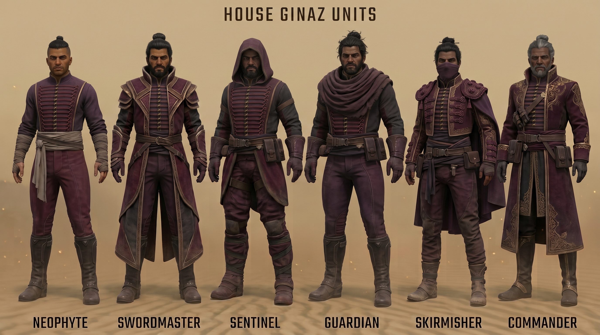

# Units

Concept roster: five lines. One is built (the Captain fills the Trooper role). Squad sizes, looks and the build ideas below are
from the concept render plus our model catalog; **stat numbers are sketches, not final**.

## Overview
| Unit | Squad | Role | Weapon | Armour | Status |
|---|---|---|---|---|---|
| **Scout** | 3 | fast recon / skirmish, finds Kanly targets | rapier | none (hat, short jacket) | not built |
| **Troopers** | 4 | core line infantry | long rapier | wine coat, brown mantle/chest plate | **built as the Ginaz Captain** (squad 5, in game) |
| **Throwers** | 3 | ranged-ish harassers (thrown daggers; no firearms) | throwing daggers | bandoliers, wine coat | not built |
| **Elite Swordmaster** | 4 | elite duellist | curved sabre or dual rapiers | leather cuirass, gold embroidery | not built |
| **Master of Ginaz** | 1 (hero) | leader unit, aura source | long sabre | full gold filigree, cape, two banners | not built |

Costume rule across all: **more gold embroidery = higher rank**, armour is leather and brown, never steel (see [art_direction.md](art_direction.md)).

## Scout
Wide-brimmed hat, wine/brown short jacket with a shoulder strap, grey trousers, tall boots, rapier; lighter and browner than the others.
- **Role:** fast, low health; scouts regions, spots Rivals, can start Kanly interactions; evasion bonus from the faction.
- **Look plan:** Ranger or Idualis body (lean), remove the Ranger's baked rifle (`kitbash_explore` V6 did this), swap head for a hat. **No hat model has been found**; options: model a brim (like the collar) or reuse a hooded/hat head from a donor (check Raider/Free Company/Skirmisher).
- **Anim set:** `MilitaryCommon` (Male01) or `Female01` equivalents if a female body is used.
- **Game slot idea:** a Ranger/recon-type slot.

## Troopers = Ginaz Captain (built)
Long wine coat to the shin, gold studs, grey chest plate, black beard, long basket-hilt rapier: our Captain already matches this panel.
See [ginaz_captain.md](ginaz_captain.md). Squad 4 in the concept; ours is 5 because the Warden slot had a 5-person Elite parent.

## Throwers
Wine coats, crossed leather bandoliers, belt pouches, throwing daggers raised overhead in a throwing pose.
- **Rule check:** daggers are not firearms; this unit is the House's only ranged option, so the rules text must say "no firearms and no shields", not "no ranged".
- **Look plan:** a coat body like the Captain's plus crossed bandoliers (the Raider tunic has sash/strap islands we removed for the Captain: they could be kept and recoloured instead; check other donors with the gallery sheets), dagger sheath props. Weapons: the Ecaz `LittleSword` (small blade) or a dagger from the `DoubleKnife` set.
- **Anim set:** the game has `Anim/Male01/DoubleKnife` (Ecaz Fencer dual-knife set). A throwing animation would need checking against `AttackRange`/`AttackLaunch` clips (`Anim_Male01_AttackLaunch.fbx` exists) and a projectile entry in data.
- **Game slot idea:** a ranged infantry slot with a custom projectile.

## Elite Swordmaster
Ornate coats with gold embroidery, curved sabres or dual rapiers, low duelling stances. The duelist image (`images/art_duelist_dual_rapiers.png`)
gives the armour: brown leather cuirass with a gold embossed chest, wine sleeves with gold shoulder embroidery, long open wine coat with filigree borders.
- **Look plan:** same body as the Captain, add a leather cuirass (recolour the Mercenary's chest to brown leather instead of filling with the Raider tunic), gold filigree painted on the coat borders and sleeves; second rapier in the off hand via a second baked weapon on `B_Weapon_L` (Female01) or the `DualSwords` Male01 anim set.
- **Anim set:** `Anim/Male01/DualSwords` (exists: AttackMelee01/02, FightIdle, Run...). Needs the model entry to inherit a dual-sword set.
- **Game slot idea:** the Elite slot (currently held by the Captain), or a new unit.

## Master of Ginaz
Full cape, tall gold-rimmed collar, gold filigree coat, long sabre, two wine banners on poles flanking him (a hero with banner props). Portrait: grey-streaked beard.
- **Look plan:** the Captain body plus a cape (Cape bones `B_Cape01-03` exist on the rig and clips animate them: the Mercenary's original cape islands could be kept and recoloured), banners as separate props or dyn-objects.
- **Anim set:** a hero set (`Duncan` has Skill/AttackRange; `Anim/Male01/Gurney`, `Knight`, `Rabban`...).
- **Game slot idea:** a hero slot; pairs with the Grandmaster choice (see [leaders_and_councilors.md](leaders_and_councilors.md)).

## Stat sketch (relative to the Warden: 500 hp / 16 power / 8 armor)
These are starting points to playtest, matching the faction idea of evasion over armour.
| Unit | Health | Power | Armor | Notes |
|---|---|---|---|---|
| Scout | 200 | 8 | 1 | fastest; +evasion |
| Trooper | 350 | 11 | 3 | core line |
| Thrower | 220 | 12 (ranged) | 1 | short range |
| Elite Swordmaster | 450 | 18 | 4 | parry-heavy |
| Master | 900 | 28 | 6 | aura, execute |
| (Captain as built) | 500 | 16 | 8 | unchanged Warden stats, see [ginaz_captain.md](ginaz_captain.md) |

## Build order (suggested)
1. Captain upgrades from the officer portrait (brown mantle, gold buttons/piping/hem discs): texture only.
2. Elite Swordmaster (reuse the Captain geometry + leather cuirass + second rapier).
3. Master of Ginaz (cape + banners).
4. Scout (needs hat solution).
5. Throwers (needs a ranged/projectile setup).
Each unit follows the saved `dsw-new-unit` skill; each costs roughly one session once the donor ids are known.

## Female units (Selene, Mei Ling)
Female01 bodies exist (Free Company, Ranger, Warden, Skirmisher...). The kitbash method works across Male01/Female01 (same bone names plus a few extras);
check shoulder/neck fit by eye. Two rapiers for Mei Ling: `Anim/Female01/DualSwords` exists.

## Source roster sheet (original colour design)

The original "HOUSE GINAZ UNITS" sheet (`model_inputs/house_ginaz_roster.jpg`): the **Commander** figure on the right was the source of the colour
palette (plum coat, plum armour, gold trim, dark under-suit) used by the earlier Commando recolour and by the Captain.
