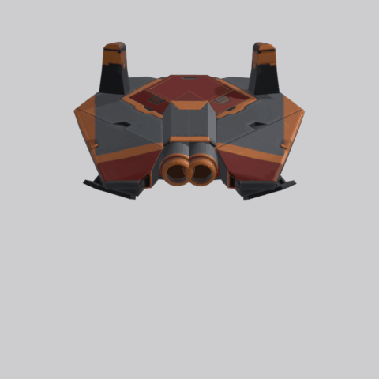
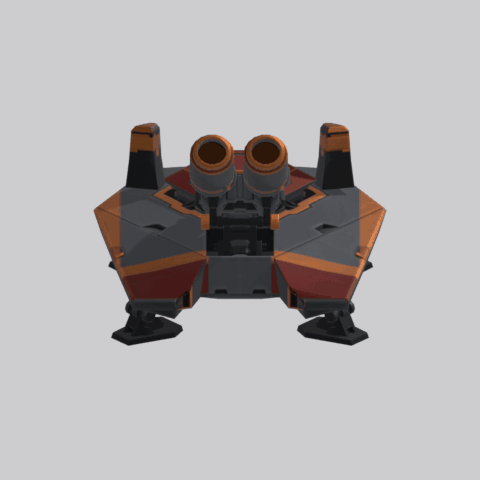
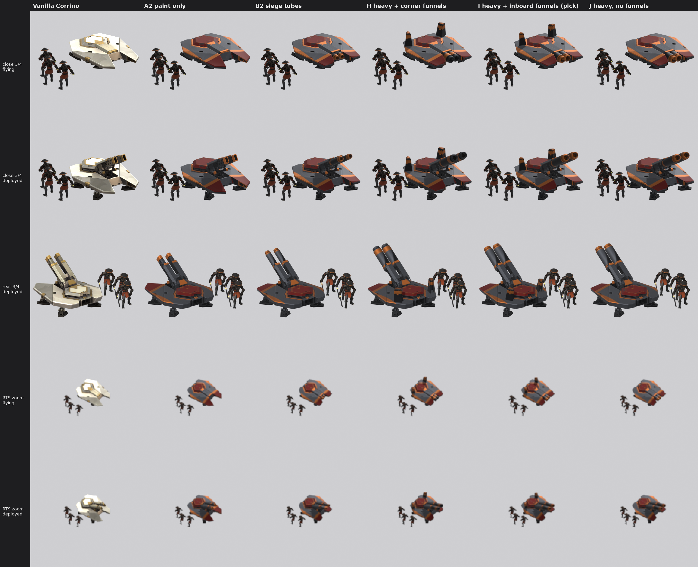

# Thorvald Artillery Drone (`TH_Drone` / `TH_Drone_Deployed`, model row `Th_Drone`)

**Status (2026-11-26, cloud session "artillery-drone"):** model pass done. Game files built in
`06_game_ready/VehMOD/ThorvaldDrone/` and checked by a round trip. **Not installed. `mod_files/data.cdb`, `hlboot.dat`, the pak and the
game folder were not touched.** Today `Th_Drone` still points at Corrino's `Vehicle/Imperial/DroneI/Prefab_DroneC.prefab`.

 

## The pick: variant I, "heavy barrels + inboard funnels"

It is still the Corrino artillery drone (same arrowhead hull, legs, hex lid, gun mount, size, rig and every animation), made Thorvald's:

| | What | How |
|---|---|---|
| Removed | the launcher tips (the gold-capped box ends on `B_CanonR/L_Shoot`), the gold clip tabs on the wing edges, the gold inserts in the wing points | whole faces by bone / box (`remove_bones`, `remove`) |
| Removed | the Corrino emblem on the channel's front face and the marks on the breech-box sides | painted out: inpainted with the surrounding panel's own value (`base` paint role), metal/gloss too |
| Reshaped | wing points blunted to x = -0.92 | vertices clamped, no holes (`retail` clamp) |
| Added | twin heavy barrels: two **Renegade Frigate tubes**, the same donor as the Th_Ship's twin chin barrels (family resemblance). 0.9 long, copper muzzle ring and breech ring | skinned to `B_CanonR/L_Shoot`, so they slide back into the breech boxes on recoil exactly as the vanilla tips did |
| Added | two **Vernius Tesla-drone towers** as foundry funnels flanking the lid, tilted back 12 deg, copper caps | skinned to `B_Main` |
| Paint | polished charcoal and gunmetal two-tone from the vanilla panel values; oxblood wing fronts with a bold copper collar behind (as the Th_Ship's oxblood nose); copper outer wing edge; oxblood hex badge in a copper frame on the lid; Corrino gold trim -> copper | `41_paint.py`, rules in `01_input/v3.json` |

Why I and not the others (see the sheet): the heavy barrels give the strongest "artillery" read, deployed and even flying (two
copper-ringed muzzles between the wings); the funnels add a vertical rear element no other drone has and tie it to the house's
foundry identity; unlike G they keep the oxblood lid badge, which is the strongest mark at RTS zoom. **J** is the same drone
without funnels, the fallback if the funnels are too much. Every variant can be rebuilt from its spec.



## Variants

| Sheet | Variants | Spec |
|---|---|---|
| `02_progress_photos/04_variants_final/variants_compare.png` | vanilla, A2 paint only, B2 siege tubes, H heavy + corner funnels, **I (pick)**, J heavy no funnels | A2/B2/H: `01_input/v2.json`; I/J: `01_input/v3.json` |
| `03_variants_r2/variants_r2.png` | A2, B2, F siege + corner funnels, G siege + stacks in the lid, H | `v2.json` |
| `02_variants_r1/variants_r1.png`, `01_geometry_r1/geometry_r1.png` | A gunmetal, B siege tubes, C foundry stacks, D ironclad (thicker wings, invisible at RTS: dropped), E all | `v1.json` |
| `00_vanilla/check_builder_V0.png` | the vanilla drone directly vs through the builder (identical: the pipeline keeps the rig) | `v0.json` |

Rows on every sheet: close three-quarter flying (DroneC `Idle` frame 0) and deployed (`Opening` frame 44, the end pose), rear
three-quarter deployed, and RTS zoom (rendered at 1/3 size and blown up, so detail that vanishes in game vanishes here), with three
Thorvald troopers (scale 1.0) beside the drone (scale 2.1, as the `Th_Drone` row).

## Game files (`06_game_ready/VehMOD/ThorvaldDrone/`)

| File | |
|---|---|
| `ThorvaldDroneBase.hmd` | the four legs (unchanged geometry, our texture) |
| `ThorvaldDroneCanon.hmd` | hull, lid, gun mount, breech boxes, barrels, funnels; 3 materials |
| `ThorvaldDrone_*`, `ThorvaldDrone_Tube_*`, `ThorvaldDrone_Funnel_*` `{Albedo,MetallicGlossAO,Normal}.png` | real PNG, as the installed Th_Ship |
| `Prefab_ThorvaldDrone.prefab` | the vanilla `Prefab_DroneC` with our two models; `MuzzleA/B` still constrained to `B_CanonR/L_Shoot`, moved out to the new barrel mouths (z 0.1 -> 0.491, same set-back as vanilla) |
| `materials.props`, `props.json` | PBR, emissive 0.1 as the vanilla drone; animations `/Anim/DroneC` |

### For the owner's local session (merge, then)
1. Stage: add to `SOURCES` in `mod_files/stage_and_pack.py`:
   `"VehMOD/ThorvaldDrone": os.path.join(TH, "thorvald_artillery_drone", "06_game_ready", "VehMOD", "ThorvaldDrone"),`
2. The one cdb change: model row `Th_Drone`, mesh path -> `VehMOD/ThorvaldDrone/Prefab_ThorvaldDrone.prefab`. Keep `rigName` 11,
   `inherit` DroneDeployable, `scale` 2.1, audio and FX (the prefab is the vanilla one with our models, same bones):
   `python .claude/skills/dsw-model-modding/scripts/cdb_tools.py set-mesh --ids Th_Drone --mesh VehMOD/ThorvaldDrone/Prefab_ThorvaldDrone.prefab`
   (back up first, as always; revert = the same command with `Vehicle/Imperial/DroneI/Prefab_DroneC.prefab`).
3. `cdb_validate.py --vanilla ...`, `engine_preflight.py`, pack, test. In the game, check: the drone flies and deploys, the
   barrels rise, the muzzle flash comes out of the barrel mouths, the barrels recoil into the breech boxes, the funnels and
   badge read at normal zoom.

## How the HMDs were made (and why not the toolkit conversion)

The toolkit's FBX -> HMD step (`51_convert_vehicle.py`) runs the game's `D4X.exe`, which the cloud session does not have, and it
rebuilds the skeleton (the bind-rotation fault `53_fix_bind.py` repairs). Here each HMD is the **vanilla drone HMD with only its
geometry and materials replaced** (`60_write_hmd.py`, `hmd_writer.py`):
- joints, bind poses, model name and transform are copied unchanged, so `53_fix_bind.py` is not needed;
- every vanilla vertex that survived the kitbash keeps its original record (normal, tangent, UV, weights, joint indexes);
- grafted vertices get positions/normals mirrored back (hmd2fbx's x pre-mirror), v flipped, triangle winding reversed, tangents from
  the UV gradient, weights mapped to the HMD's bind slots;
- several materials on one skinned model with no skin split is vanilla practice (Chronos, Harvester, Ecaz drone).

Checks (all in this session): `hmd_writer.py --selftest` re-writes 7 vanilla and Thorvald HMDs (drone, Hammer, Thorvald ship,
frigate, trooper, elite) byte for byte; the unchanged drone sent through builder + writer gives vertex and index data bit-identical
to vanilla; computed tangents match the vanilla ones (median dot 1.000, 99.9 % > 0.9).

## Verification of the pick (`61_roundtrip.py`; numbers in `02_progress_photos/06_roundtrip/roundtrip_numbers.json`)
- Our HMDs read back by the toolkit (`hmdanim2fbx`) and rendered beside the vanilla drone, flying and deployed, front/side/three-quarter:
  `02_progress_photos/06_roundtrip/roundtrip_sheet.png`; the deploy animation side by side: `deploy_roundtrip.gif`.
- Both sit level and face the same way: identical ground contact (min z -0.003 deployed) and width; differences are only the
  blunted points, the funnels (+0.34 high) and the longer barrels.
- `dsw-model-modding/scripts/check_hmd.py` on both HMDs (res root = a tree holding `VehMOD/ThorvaldDrone`): normals 100 % agree with
  triangle facing, no zero-length normals, every texture path resolves, `materials.props` found. Its only "FAIL" is the skeleton
  comparison against the Male01 character rig, which does not apply to a vehicle; the skeletons are identical to the vanilla drone's.
- Muzzles, engine maths in HMD space (barrel-tip vertices skinned with the decoded clip): vanilla puts MuzzleA/B 0.138/0.145 behind
  the barrel mouth, ours 0.146/0.152, at Opening frame 44 and at two recoil frames of AttackRange.

## Rebuild
Run from this folder. On the owner's PC use `blender -b --factory-startup --python <script> -- ...` for the Blender steps;
the cloud session ran the same scripts with the pip `bpy` 5.2 module (`python <script> -- ...`).
```
python 08_scripts/10_bake_clips.py                                   # DroneC clips baked on the vanilla parts (01_input/anim_fbx)
blender ... 08_scripts/20_build_drone.py -- 01_input/v3.json          # geometry -> 03_blender/variants/<v>_geo.blend + _geo.npz
python 08_scripts/41_paint.py 01_input/v3.json                       # textures -> 04_textures/<v>/
blender ... 08_scripts/42_apply_paint.py -- I_heavy_inboard_funnels   # -> 03_blender/variants/<v>.blend (packed)
blender ... 08_scripts/30_render_sheet.py -- <out.png> vanilla,A2_paint_only,... --squad   # comparison sheet
blender ... 08_scripts/35_turntable.py -- I_heavy_inboard_funnels fly|dep <out.gif>
blender ... 08_scripts/60_write_hmd.py -- I_heavy_inboard_funnels     # -> 06_game_ready/VehMOD/ThorvaldDrone/
blender ... 08_scripts/61_roundtrip.py -- --gif                       # round trip, numbers, sheet, deploy GIF
```
`03_blender/thorvald_artillery_drone_final.blend` is the pick (two armatures + two skinned meshes, textures packed). Variant blends,
textures and baked clips are regenerable and not committed (`.gitignore`).

## Facts about the vanilla drone (measured)
- Two HMDs on one 22-bone rig: `ImperiumDroneBase` = legs only (`B_TopFoot_*`, `B_MidFoot_*`), `ImperiumDroneCanon` = hull `B_Main`,
  lid `B_Head`, gun mount `B_GearCanon*`, plate `B_GearPlate*`, breech boxes `B_CanonR/L`, launcher tips `B_CanonR/L_Shoot`.
- Clips: Opening 45 frames (deploy), Closing 41, AttackRange 59 (the `_Shoot` bones slide 0.41 along the barrel: recoil), Idle/Run
  only move `B_Main`/`B_RootBase`, Death 81. Flying, the launcher lies flat in the channel between the wings.
- Mesh data (as hmd2fbx writes it) is the HMD frame, Y up. Build space = R @ data, R = [[0,0,-1],[-1,0,0],[0,1,0]]: bind pose in
  Blender world, Z up, gun toward -X, launchers raised ~32 deg. The leg armature's rest bones are in that frame.
- Each baked clip FBX has its own armature rest (hmdanim2fbx writes the clip's first frame into it): an action cannot be moved
  between armatures, so variants are posed by putting their meshes on the clip's own armatures (`drone_scene.load_variant`).
- Left and right parts share UV space, so paint rules placed in 3D must be mirror-symmetric (`41_paint.py` tests |y|).

## Risks / not done
- **Not seen in game.** The HMDs are written by a new tool (template swap), not by the toolkit conversion; the checks above are
  strong but the game is the judge.
- Emissive: MGAO alpha is 1 everywhere with `emissive` 0.1, as the vanilla drone. No glow on the funnels (possible later).
- No FBX for the toolkit route was made (it needs `D4X.exe`); `03_blender/thorvald_artillery_drone_final.blend` can be exported if wanted.
