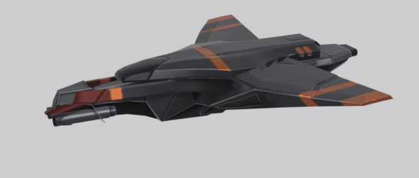
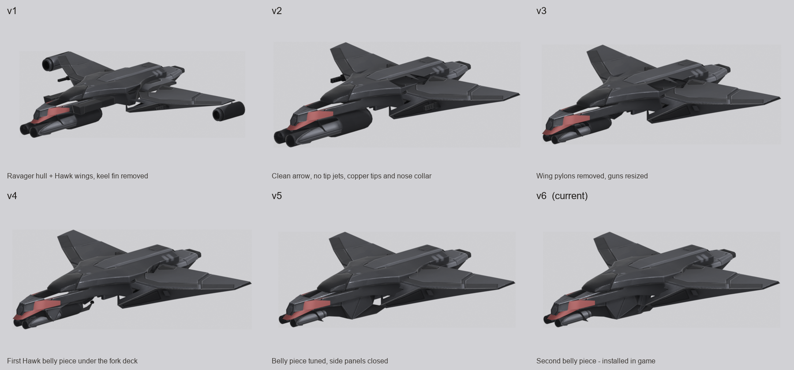

# Thorvald Ship (`Th_Ship`, the Thorvald fighter)



**Current version: v6.** It is the model installed in the game for the Thorvald faction. Not yet seen in game: facing, size and muzzle
positions still need a check.

## Versions

Six milestones on the path to the installed model. Each has its build spec, one Blender file and four renders (three-quarter, top, side,
underside). Side explorations are archived (see the end of this page).



| Version | What changed | Build spec | Blender file |
|---|---|---|---|
| v1 | Vanilla Ravager hull with Hawk wings and Renegade-tube pods and barrels, ventral keel fin removed. Busy: wing-tip jet pods, side gun rods | [v1.json](01_input/v1.json) | [v1_ravager_hawk_wings.blend](03_blender/v1_ravager_hawk_wings.blend) |
| v2 | Style pass, picked from 13 variants: clean arrow silhouette, no tip jets, two-tone, copper wing tips and nose collar | [v2.json](01_input/v2.json) | [v2_arrow_polish.blend](03_blender/v2_arrow_polish.blend) |
| v3 | Wing pylons removed, chin guns resized to the twin Renegade-tube barrels | [v3.json](01_input/v3.json) | [v3_no_pylons.blend](03_blender/v3_no_pylons.blend) |
| v4 | First Hawk fuselage piece added under the fork deck, to close the open underside | [v4.json](01_input/v4.json) | [v4_first_belly.blend](03_blender/v4_first_belly.blend) |
| v5 | That belly piece resized and moved, side panels clamped so they stay closed without spikes | [v5.json](01_input/v5.json) | [v5_belly_tuned.blend](03_blender/v5_belly_tuned.blend) |
| **v6** | Second belly piece, final textures. **Installed.** | [v6.json](01_input/v6.json) | [v6_final.blend](03_blender/v6_final.blend) and [v6_final_tex.blend](03_blender/v6_final_tex.blend) (textured) |

Renders are in `02_progress_photos/<version>/`. v6 also has [a textured four-view sheet](02_progress_photos/v6_final/v6_final_tex_sheet.png).

## v6 at a glance

- **Game slot:** unit `TH_Ship` / `Th_Ship` -> model `Th_Ship` -> `VehMOD/Thorvald_Ship/Prefab_Thorvald_Ship.prefab`. Hammer rig (rigName 21, inherit
  Hammer), model scale 1.6. Only the mesh is ours; animations, rig and audio are the vanilla Hammer's.
- **Parts (all from vanilla game models):** Ravager host, Hawk wings, Hawk nose inset, two Hawk fuselage belly pieces, Renegade tubes as the twin chin barrels.
- **Textures:** one 1024x1024 atlas, two-tone with copper only on up-facing faces (`THV_PAL=twotone THV_CU=heavy THV_UPONLY=1`).
  [04_textures/](04_textures/) holds the albedo, metallic/gloss/AO and normal maps.
- **House rule:** every added part comes from an existing game model, never hand-modelled primitives.

## Folder map

| Folder | What is in it |
|---|---|
| `01_input/` | Build specs `v1.json` to `v6.json` |
| `02_progress_photos/` | `versions_lineup.png` and one folder of four renders per version |
| `03_blender/` | One `.blend` per version, plus the textured v6 |
| `04_textures/` | Final v6 texture maps |
| `05_fbx_export/` | `Thorvald_Ship.fbx` (v6 skinned to the Hammer armature) |
| `06_game_ready/` | The converted `VehMOD/Thorvald_Ship` files as installed |
| `07_data_cdb/` | The `Th_Ship` model row edit and the bind-pose backups |
| `08_scripts/` | The pipeline scripts, numbered in run order |
| `09_roundtrip/` | The converted model re-imported and rendered, to check facing and bind pose |

## Rebuild and install

All commands run from this folder. Blender 5.2 is `C:\Program Files\Blender Foundation\Blender 5.2\blender.exe`.

```
# 1. geometry from a spec (writes 03_blender/<name>.blend and renders into 02_progress_photos/<name>/)
blender -b --factory-startup --python 08_scripts/20_build_variant.py -- 01_input/v6.json

# 2. textures: dump geometry, build the atlas, apply it (writes the textured blend and tex_*.png renders)
blender -b 03_blender/v6_final.blend --python 08_scripts/40_dump_geo.py -- 04_textures/_geo.npz
THV_UPONLY=1 THV_PAL=twotone THV_CU=heavy python 08_scripts/41_make_atlas.py
blender -b 03_blender/v6_final.blend --python 08_scripts/42_apply_atlas.py -- 03_blender/v6_final_tex.blend <render_dir> --turntable 36

# 3. game export
blender -b 03_blender/v6_final_tex.blend --python 08_scripts/50_export_fbx.py -- 05_fbx_export/Thorvald_Ship.fbx
python 08_scripts/51_convert_vehicle.py 05_fbx_export/Thorvald_Ship.fbx
python 08_scripts/53_fix_bind.py <converted .hmd> <vanilla Hammer ref>    # required, see below
python 08_scripts/52_cdb_edit.py                                          # --revert undoes it
```

Then validate the cdb and repackage as described in the repo's `CLAUDE.md`.

- **53_fix_bind is required after every export.** The toolkit writes a wrong B_Body bind rotation that would pitch the ship 90 degrees in game.
- **Gap check:** `47_diag_parts.py` renders flat colour per part, and true holes show green.
- **GIF:** render the turntable frames with step 2's `--turntable`, then `python 08_scripts/12_make_gif.py <frames> <out.gif> 60`.
  `thorvald_ship_current.gif` was cropped to the ship's extent.
- If the game shows the ship the wrong way round or the wrong size, adjust `GEO` and `ZC` in `50_export_fbx.py` and `51_convert_vehicle.py`, then redo step 3.

## Archive

Everything else from this project (the `poc` donor tests, the Ravager, slab and sleek explorations, the 13 style variants, donor surveys, gap
diagnostics, backups and old render sheets) is in `model_projects/_archive_unused/thorvald_ship_wip/`, with a `MANIFEST.txt` that maps old names
to new ones. It can be deleted once you are sure nothing from it is wanted.
