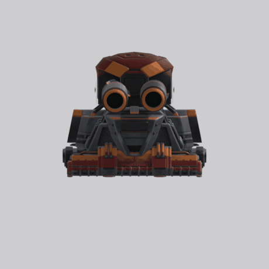
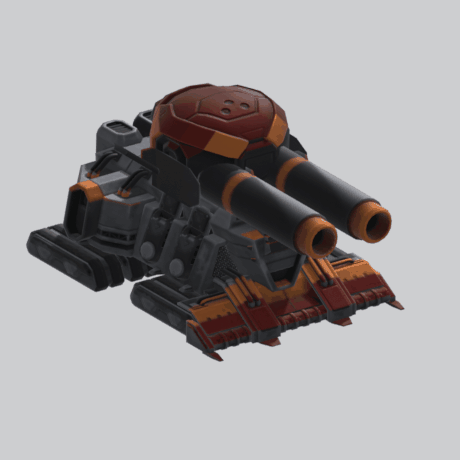

# Thorvald turret gunship (`TH_Drone`, model row `Th_Drone`): non-deploying, shoots like a tank

**Status (2026-11-27, cloud session "artillery-drone"):** owner follow-up to the artillery-drone pass
(`../thorvald_artillery_drone/`): the drone should not deploy, should just shoot like a tank, have a turret with two barrels,
look sturdier and differ from the artillery drone. Model, textures, clips and game files are done and checked by a round trip.
**Not installed; `mod_files/data.cdb`, `hlboot.dat`, the pak and the game folder were not touched.**

 

## Turret: fixed, the body aims (owner's choice)
DSW does not swivel a unit's turret toward its target: units turn their whole body to aim; turret-turning code exists only for
the Missile Battery building, by its id (`house_thorvald/handoff_hook_catalog.md`). The owner chose "turret fixed, body aims":
the turret is part of the hull and the whole tank turns to fire, as every DSW unit does. Data only, no engine patch.

## The pick: G1 "tank"
| | What | From |
|---|---|---|
| Rig | the Renegade drone's: one HMD, bones B_ROOT, B_Body, Wing, B_CanonR/L (+ _Shoot); never deploys | `Vehicle/Common/Ravager_Drone` (rig 25, model row `N_Renegade_Drone`: inherit DroneCommon, scale 3.1) |
| Removed | the whole Renegade drone body, fin and guns | host |
| Hull | the Atreides harvester's armoured body ON ITS TRACKS (tracks keep their own texture set) | `Vehicle/Atreide/Harvester` (body + `Harvester_chenil`) |
| Turret | the Harkonnen combat drone's dome, flattened and turned 180 deg (smooth back forward) | `Vehicle/Harkonnen/DroneH` |
| Barrels | twin heavy Renegade Frigate tubes, straight forward through the cannon pivots (the Th_Ship / artillery drone barrel donor) | `Vehicle/Common/Renegade_Frigate` |
| Paint | charcoal/gunmetal hull, the harvester's small orange/green details erased, charcoal tracks; oxblood front deck + bold copper band, copper stripe along the upper sides; oxblood turret roof with copper; copper muzzle and breech rings | `01_input/g3.json` paint rules |

Variants on the sheets: `02_progress_photos/01_round1` (cargo-drone block hull + dome, T1/T2), `02_round2` (tracked/hover harvester
chassis, dome options, funnels), `03_round3/gunship_r3.png` (calmer paint; G1 = pick, R2A flat dome, R2D hover hull), each beside
the vanilla Renegade drone, the artillery-drone pick and three troopers. Specs `01_input/g1.json`..`g3.json`.
Why G1: tracks and a turret read as a tank at once; it is the heaviest silhouette and shares nothing with the artillery drone's
arrowhead; the turned dome has no dark cavity at the front; funnels (R2C) only added clutter next to the harvester's own stacks.

## Tank clips (`06_game_ready/VehMOD/ThorvaldGunDrone/Anim/`, `08_scripts/50_clips.py`)
The Renegade drone hovers: its Idle bobs B_Body ~0.1 (0.3 m in game) and Run rolls it ~8 deg. On tracks that floats, so the five
DroneR clips are copied and only B_Body is rewritten: Idle/FightIdle/Run hold it still and level at the built height;
AttackRange keeps the recoil jolt along the barrel axis (no lift); Death unchanged. The cannons' own motion (a roll about the
barrel axis, invisible on round barrels) is untouched. Files keep the names `Anim_DroneR_<Clip>`; the model's `props.json`
lists only this folder in `hmd.animPaths`, so they apply to this model alone. The HMD's default B_Body pose is set to the same
level pose (Idle has no rotation track and the vanilla default carries a 6 deg roll).

## Game files (`06_game_ready/VehMOD/ThorvaldGunDrone/`)
`ThorvaldGunDrone.hmd` (4 materials: Hull, Tracks, Turret, Barrels; 12,955 verts / 16,210 tris: the harvester body is detailed),
the `ThorvaldGunDrone_<Part>_{Albedo,MetallicGlossAO,Normal}.png` sets, `Prefab_ThorvaldGunDrone.prefab` (model +
`MuzzleA` on B_CanonR, `MuzzleB` on B_CanonL, 0.15 inside each barrel mouth, facing down the barrel), `materials.props`
(emissive 0.1), `props.json` (`/VehMOD/ThorvaldGunDrone/Anim`), `Anim/` (5 clips). Written by `60_write_gunship.py`: the
vanilla Ravager_Drone HMD with new geometry/materials (joints and binds copied; artillery drone's `hmd_writer.py`).

### For the owner's local session
1. `mod_files/stage_and_pack.py` `SOURCES`:
   `"VehMOD/ThorvaldGunDrone": os.path.join(TH, "thorvald_turret_drone", "06_game_ready", "VehMOD", "ThorvaldGunDrone"),`
2. Model row `Th_Drone`: mesh `VehMOD/ThorvaldGunDrone/Prefab_ThorvaldGunDrone.prefab`, **rigName 25, inherit DroneCommon**
   (the Renegade drone's, `N_Renegade_Drone`), scale 3.1 (same footprint as the artillery drone; lower it to shrink).
3. Unit rows (gameplay, your call): `TH_Drone` loses `deployAbility`/`deployedCombo`/`deployTime` and gets an attack combo that
   fires from `MuzzleA`/`MuzzleB` (e.g. a copy of `Th_Drone_Attack`, which already does); `TH_Drone_Deployed` becomes unused.
4. Validate, preflight, pack, test: the tank drives and idles level on its tracks, turns to aim, the muzzle flashes leave the
   barrel mouths, the barrels recoil the hull back slightly.

## Verification (`08_scripts/61_roundtrip.py`, numbers in `02_progress_photos/06_roundtrip/roundtrip_numbers.json`)
- Engine maths in HMD space, every 2nd frame of every clip: Idle/FightIdle/Run lowest point z 0.003 on every frame, bounds
  constant (no bob, no roll); AttackRange the same plus the 0.064 recoil jolt; both muzzles exactly 0.150 behind the barrel
  mouths in every frame. Death keeps the vanilla drone's crash (the wreck tumbles and partly sinks).
- Our HMD + clips read back by the toolkit and rendered beside the vanilla Renegade drone: `roundtrip_sheet.png`.

## Rebuild (run from this folder; Blender steps as `blender -b --factory-startup --python <script> -- ...` on the owner's PC)
```
python 08_scripts/10_bake_clips.py                       # vanilla DroneR clips on the host (01_input/anim_fbx)
python 08_scripts/50_clips.py                            # tank clips -> 06_game_ready/VehMOD/ThorvaldGunDrone/Anim/
python 08_scripts/10_bake_clips.py --tank                # tank clips baked for previews (01_input/anim_fbx_tank)
blender ... 08_scripts/20_build_gunship.py -- 01_input/g3.json G1_tank
python ../thorvald_artillery_drone/08_scripts/41_paint.py 01_input/g3.json G1_tank --proj .
blender ... ../thorvald_artillery_drone/08_scripts/42_apply_paint.py -- G1_tank --proj .
blender ... 08_scripts/30_render_sheet.py -- <out.png> vanilla,artillery,G1_tank --squad --tank-clips
blender ... 08_scripts/60_write_gunship.py -- G1_tank
blender ... 08_scripts/61_roundtrip.py -- --gif
```
`03_blender/thorvald_turret_drone_final.blend` = G1 (armature + skinned mesh, textures packed). Shared tools live in the artillery
drone project (`20_build_drone.py` helpers incl. multi-material donors, `41_paint.py`, `42_apply_paint.py`, `hmd_writer.py`).

## Risks / open
- Not seen in game. New in this pass on top of the artillery drone's checks: own clip files (copied vanilla clips with one track
  rewritten, so the format is the engine's own) and a changed default pose for B_Body.
- Death: the vanilla hover-drone crash (falls from hover height); a tank-specific death is not made.
- 16k tris is above most units (the vanilla harvester has ~14k); a decimation pass is possible if it costs frame rate.
- The artillery-drone game files (`../thorvald_artillery_drone/06_game_ready/VehMOD/ThorvaldDrone`) stay valid if you prefer to
  keep the deploying version.
