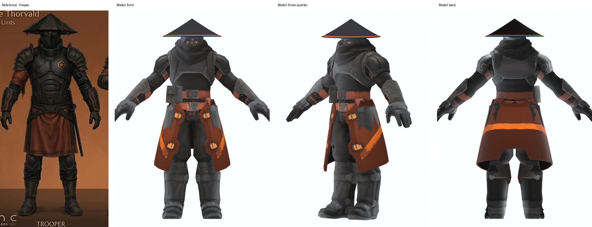
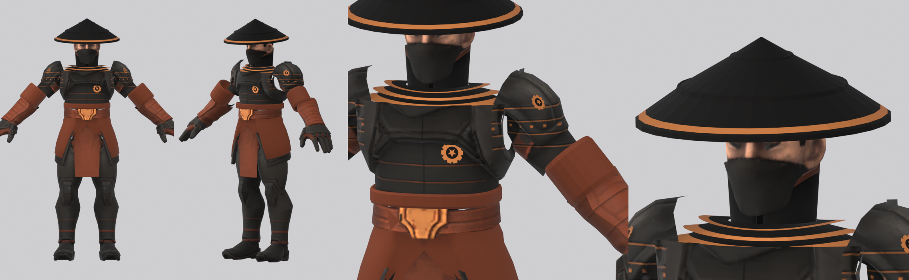
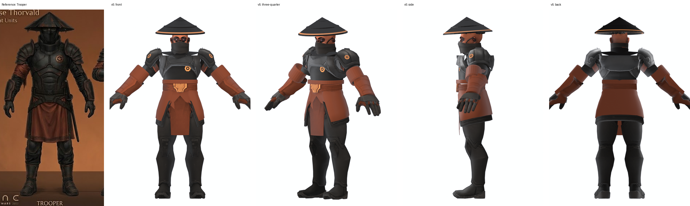
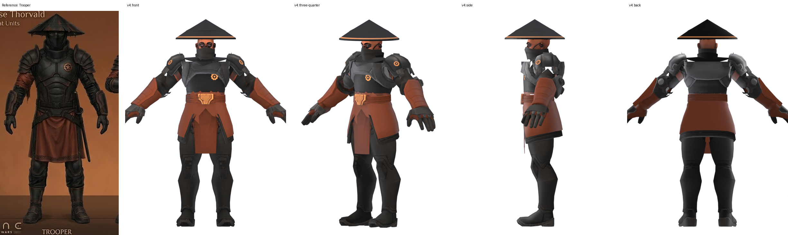
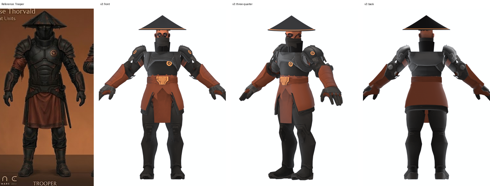
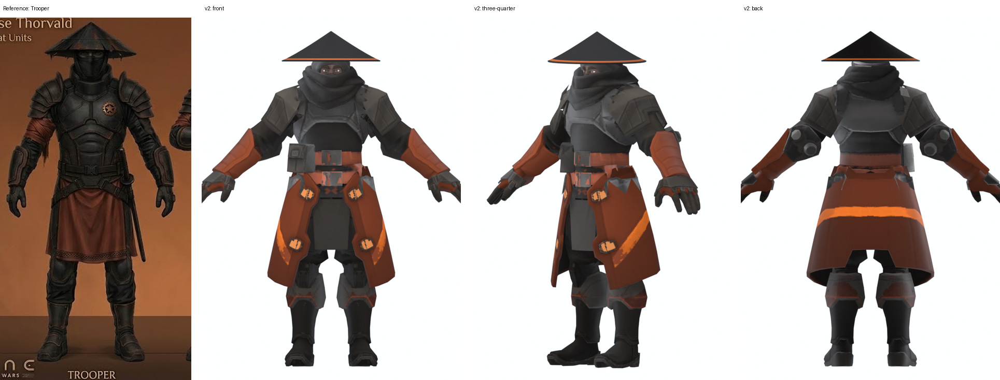

# thorvald_trooper - project notes

House Thorvald's **Trooper**, kitbashed from existing game parts to match the left-most figure on
`house_thorvald/images/art_combat_units_sheet.jpg`. Stage reached: **preview .blend + real-clip animation test.
Not exported to the game** (no HMD, no `data.cdb` entry, nothing installed).

## v6 (current): new head, outstanding issues fixed, upscaled to vanilla level

Recipe `T4_Trooper` (`08_scripts/03_variants_trooper.py`), finished with `bash 08_scripts/run_final.sh` (rebuild, recolour, merge duplicate materials, x2 painted upscale, matte previews, audit).
Deliverable: `03_blender/Thorvald_Trooper_v6.blend` (1024 maps packed). Work folder: `10_upscale/` (before/after audits, renders, textures).

**Head.** Surveyed 12 head donors (`09_heads`, `heads_sheet.png`). The Idualis02 head clashed (a different art style, noisy eye texture, borrowed red mask). The **Commando's own head** already has a
black cloth half mask (nose to chin) and sculpted hair, in the same style and on the same texture atlas as the body, so it blends and drops a material. It has no neck, so the stand collar now rises to the
skull base at the back (1.785) and has a rust rim band so it reads apart from the mask. The head is scaled 1.08 and the hat radius is 0.275.

**The outstanding issues from v5**

| Issue | Fix |
|---|---|
| Hairline shards and white slits at the shoulders | 7 sliver faces removed; small open loops at the armpit (5 to 6 edges, the slits) capped with `fill_small_holes`. A stricter sliver filter (aspect 6) was tried and reverted: it cut slits through the chest plates |
| Flat yoke plate | A layered, copper-edged yoke of 3 stacked tiers (`tiers`), single-walled to save triangles; rounded after the first version grew thin copper horns at the sides |
| Back of the head bare | The Commando head has hair |
| Plate shine | Mostly the importer preview wiring (whole MG colour as specular), not the model; checked in the game-style matte preview, where the plates are dark. No texture change needed |
| Broad shoulders | `slim_arm` 0.88: shoulder pad + sleeve scaled towards the arm axis, faded to nothing where the sleeve meets the torso (a uniform scale first opened armpit slits) |
| Tall black block (collar + mask) | The collar has a rust rim band; the mask edge is ragged cloth |
| Weapon | Not added: you said to ignore it for now |

**Upscale (dsw-unit-upscale loop).**

| | before | after |
|---|---|---|
| Triangles | 11,474 | **9,162** (add-on parts slimmed: hat 28 segments, single-wall yoke, fewer ring segments). Target 7 to 9.5k, ceiling 12k |
| Main texture sets | 512 (one 256) | **1024** (the 256 set to 512); 318 to 463 texels/m, up from 159 to 231 (vanilla torso about 700) |
| Metal-gloss maps | alpha as low as 0.07 (11 audit problems) | alpha 255, **0 problems** |
| Colour drift | | 0.3 to 0.8% on every material (limit 8%) |
| Materials | 8 datablocks | 4 (duplicates merged: Commando, Duncan, Mercenary, and the Mercenary's 512 base set) |

The painted detail (`thorvald_hook.py`, in metres in the rest pose, so it is resolution independent, copper flagged as metal): lamellar bands and a rivet row on the pauldrons, chest and back panel seams
with a copper edge, boot straps with studs and a top rim, stitched bands across the forearm guards. Only parts with real UV islands can be painted; the hat, yoke, cuffs, waist and skirt tabard
point many faces at one flat texel, so they stay flat-coloured. Matched before/after renders: `10_upscale/renders/compare_details.png`.

**Checked:** game-style matte previews (before/after, same cameras), 10 culled audit views and close-ups earlier in the pass, `weight_check.py` (0 unweighted vertices on all 13 meshes),
Run, AttackMelee01 and FightIdle (`05_clips_v6/`, `clips_sheet_v6.png`).

**Not done / not verified:**
- No weapon, as asked. Not exported to the game and **not seen in the real game**: the normal-map direction (relief), the copper metal flag and the extra material draw call are unverified there.
- The hat, yoke, cuffs and waist are flat-coloured (no painted detail), and the Mercenary's second texture set (`Mat_Base`) is still only 512.
- Still 4 materials; the skill's target is 1 to 3 (+1 for metal).
- Not Sardaukar anywhere.

## v5: cleaned-up seams, hat fit and angle

`T3_Trooper` in `08_scripts/03_variants_trooper.py` (rebuild everything with `bash 08_scripts/run_t3.sh <tag>`), deliverable `03_blender/Thorvald_Trooper_v5.blend`.

**The audit.** "Choppy" was real. `audit_views.py` renders the whole figure from 10 angles with back-face culling ON (what the game shows) and `shot_multi.py` does close-ups
from 6 sides; `boundary_report.py` and `sliver_report.py` list open loops and thin shard faces. Results are in `02_progress_photos/08_audit/`.

| Found | Cause | Fix |
|---|---|---|
| Shredded shoulders: floating plates, torn cloth, see-through slots (v3/v4) | The Commando arm was cut at an arbitrary plane (|x| = 0.38) through a shoulder made of many small separate pieces | The Commando keeps its whole shoulder, pauldron and upper sleeve; the Mercenary supplies the arm from the elbow down (bone-based cut, both skeletons share the joint) |
| Sawtooth at the elbow join | Ragged bone-vote edges on both parts | Both parts cut with clean planes (sleeve trimmed 7 cm back, donor guard 4 cm forward), then a rust **elbow cuff** (`build_cuffs`) covers the join. It is sized and centred from the arm's actual vertices, not the rig's bones (they did not match the mesh) |
| Teeth and white gaps at the waist | Duncan's tabard top stood above his belt; a hairline gap under the vest | Tabard trimmed at the belt top (`zmax` 1.218), lifted 6.2 cm, plus a cummerbund ring (`build_waist`) sized from the torso cross-section |
| Stray white shards at the collar and shoulders | Thin sliver triangles left by the cuts (11 on the Commando) | `delete_slivers` (aspect ≥ 9, area ≤ 0.0015, above z 1.3): 7 removed |
| Back plate read light grey | Plate recolour value band too high | band (0.09, 0.22) to (0.05, 0.15) |

**Hat fit and angle.**
- *Fit:* the hat was 3.4× the head's width; your reference crop is about 2.8×. The head is enlarged 12% about the neck (`head_scale`), the hat radius is 0.275 (was 0.29) and the rim sits 9.2 cm below the head top, at the brow.
- *Angle:* worn tipped **forward** 4° (front brim lower) so it shades the eyes. The sculpt's hat was tilted back 5° (front lifted), which is not how these hats are worn, so I did not copy it. The roof pitch is about 32° (rise 0.18 over radius 0.275 at the hat's scale), which is my estimate of a typical conical-hat proportion, not a measurement of a real hat.
- The hat is a closed shell with two raised concentric rings, as on the sculpt.

**Checked:** 10 culled audit views, shoulder / elbow / waist / head close-ups, Run, AttackMelee01 and FightIdle (`05_clips_v5/`, `clips_sheet_v5.png`); `weight_check.py` reports 0 unweighted vertices on all 11 meshes.

**Still not right:**
- A few hairline shards remain at the shoulder-collar and at the top of the forearm guards.
- The yoke is still a flat black plate from the front and back.
- The back of the head is bare skin under the hat (no hair texture painted).
- The scalp/skin recolour and the plate shine (specular from the metal map) were not tuned; the upper back plate still catches light.
- Broad shoulders (the Commando pauldrons) and the tall black collar-and-mask block remain.
- No weapon; not exported to the game.

## v4: shoulders joined to the neck, shorter neck, new hat

`T3_Trooper` in `08_scripts/03_variants_trooper.py` (the recipe was extended in place), deliverable `03_blender/Thorvald_Trooper_v4.blend`.

| Request | What was done |
|---|---|
| Shoulders connect to the neck | Cutting the scarf off had removed the trapezius slope, leaving empty wedges between the collar and the pauldrons. A **shoulder yoke** (`build_yoke`, 440 faces) now runs from the collar over the shoulders to the vest edge and pauldron bases, double-walled, one flat black texel, weighted to SpineTop / Neck and blended into the clavicle bones towards the sides. |
| Shorter neck | Head lowered another 4.8 cm (`head_shift_z` -0.044 to -0.092) and the stand collar shortened (top 1.625 / 1.655 / 1.675). |
| Hat needs work | Built from the supplied Meshy sculpt (`01_input/hat_reference/`). See below. |

**The Meshy file.** `Meshy_AI_Ashen_Ronin_Trooper_*.blend` is a single untextured 1.1-million-triangle mesh (white material, no images) of this same Trooper, so it is a shape
reference, not an asset. It is large (68 MB). Opened with autoexec disabled.
- `extract_hat.py` fits the hat's own axis (it is tilted 5.2° with the front lifted), carves a levelled 1,500-triangle shell, and `hat_profile.py` reads its profile.
  The carved shell has gaps where the sculpt fuses the brim into the face, so it is **not** used directly.
- `build_hat_profile` rebuilds the hat as a clean closed surface of revolution from the measured profile: a slightly drooping cone (slope about 0.6 near the apex,
  steeper to the rim), a thicker band under the rim, a real rim edge. Rim radius 0.29, copper pinstripe on the rim, skinned to the head bone.
  The old paper-thin cone is kept as `build_hat`.
- **Inner rings (added after your close-up of the sculpt):** two raised concentric 3 mm ridges, as on the sculpt: a small one around the apex cap (rho ≈ 0.066) and a
  large one on the crown (rho ≈ 0.18) with the brim stepping down 4 mm outside it. They are real geometry (736 faces, 32 segments), so they catch light in a
  flat-coloured game material. Not copied: the radial slits that divide the sculpt's brim into panels.

**Checked:** neck close-ups from front, three-quarter, back and top; all views; Run, AttackMelee01 and FightIdle (`02_progress_photos/05_clips_v4/`, `clips_sheet_v4.png`);
`weight_check.py` reports 0 unweighted vertices on all 8 meshes.

**Still not right:**
- The yoke is a flat black plate seen from the front and back, a little proud of the vest edge. It reads as a gorget but has no surface detail.
- The sleeve-seam spikes and the ragged collar-plate / pauldron edge from v3 remain.
- The hat is level; the sculpt's is tilted back. The `tilt` option exists if you want a forward tilt to shade the eyes.
- Weapon ignored as requested; not exported to the game.

## v3: half mask, Duncan's waist, slimmer shoulders, emblem

`T3_Trooper` in `08_scripts/03_variants_trooper.py`, deliverable `03_blender/Thorvald_Trooper_v3.blend`.

| Request | What was done |
|---|---|
| Slimmer shoulders | The Commando keeps its own pauldrons and upper sleeve. The Mercenary supplies only from mid-arm down (|x| ≥ 0.38: sleeve end, elbow, forearm guard, gloves). |
| Duncan's sash | Duncan's belt with buckle, green sash panel and dark tabard (his islands 1 and 10, cut at z 1.26) replace the Gurney skirt, lifted 5.8 cm to meet the vest. The Commando's belt, pouch and buckle plate (islands 24, 25, 26, 40 and its ROOT-bone faces) are removed. |
| No Atreides cloth | The Gurney coat panels are gone. |
| Cloth half mask, not a scarf | The Commando scarf is cut off at z 1.585 and covered by a short black stand collar. The head is **Idualis02's**; its red mask cloth (island 5) is clipped below the chin (z 1.69) so it covers nose to chin only, recoloured black. |
| Emblem (offered earlier) | Copper gear ring, dark centre and star, as a decal raycast onto the chest and both pauldrons, each skinned to the nearest bone. |
| Hat | the pinstripe is now the same copper texel as the emblem |

Recolour: pale sash and re-pointed tabard to rust, belt to rust leather, buckle and emblem to copper, mask and hair to black, the Mercenary forearm guards to rust.

**Checked:** front, three-quarter, side, back, waist and arm close-ups, head close-ups, and Run, AttackMelee01 and FightIdle (`02_progress_photos/05_clips_v3/`, `clips_sheet_v3.png`). `08_scripts/weight_check.py` reports 0 unweighted vertices on every mesh.

**Bugs found and fixed on the way** (also in `.claude/skills/dsw-new-unit/references/lessons.md`):
- The emblem decal had 30 unweighted vertices. Stills looked perfect; the clips showed orange needles streaming off the shoulders. Weights are now set per vertex as it is made.
- Duncan's tabard shares texels with his trousers, so the legs claimed them and the skirt could not be coloured separately. The tabard's UVs are re-pointed at one flat texel.
- `neck_extend` also extruded the mask's new cut edge down to the collar, so it is not used with this head.

**Still not right:**
- Small dark spikes remain along the sleeve seam where the Commando sleeve meets the Mercenary forearm (visible only in close-up).
- A ragged edge where the Commando collar plate meets the pauldron.
- The upper face is visible (eyes and brow), as asked for a half mask; the reference is fully covered.
- No weapon (the reference has a sword on the left hip). Not exported to the game.
- The collar and mask read as one tall black block under a small head.

## v2: Duncan's legs + the Mercenary's arms

Requested after v1 read as bulky. `T2_Trooper` in `08_scripts/03_variants_trooper.py`, deliverable `03_blender/Thorvald_Trooper_v2.blend`.

| Change | How |
|---|---|
| Legs | Commando's hip, knee, ankle and ball faces removed (by dominant bone), replaced by **Duncan's** (slim tights, knee guards, boots). Both are on the same skeleton and the hip tops line up at z≈1.07. |
| Arms | Commando's shoulder through finger faces removed, replaced by the **Mercenary's** (pauldrons, sleeves, forearm guards, gloves). |
| Shoulder seam | The Mercenary's clavicle bone also owns its blue scarf and chest plate. Only its *outer* clavicle faces (|x| ≥ 0.20, the pauldron) are taken, scarf islands 6, 17, 40, 52, 60, 67 and chest plate 18, 19 are dropped, and the Commando keeps its inner collar plates. |
| Colours | Mercenary terracotta pauldrons to gunmetal, forearm guards to rust (the reference's sleeve wraps), Duncan's legs to black with gunmetal plates, centre apron panel to dark rust. |

Checked in Run, AttackMelee01 and FightIdle (`02_progress_photos/05_clips_v2/`, `clips_sheet_v2.png`): no tearing seen.

New helpers: `strip_bones`, `match` and `exclude_first` recipe keys, `keep_faces_pos`/`bone_vote` (split a bone's faces by position), and `bone_faces.py` (lists the faces each bone owns).

**Still true of v2:** the legs are lean but the Mercenary's pauldrons and forearm guards are big, so the upper body is still broad. A small
ragged edge remains where the Commando's collar plate meets the pauldron (dark on dark). No weapon, no emblem, not exported to the game.

## v1: the Commando-only build

## The recipe (`T1_Trooper` in `08_scripts/03_variants_trooper.py`)

| Piece | Source | Why |
|---|---|---|
| Body (torso, arms, legs, boots) | **Commando** (`Common/Commando`) | closest to the reference: dark, fitted suit, shoulder plates, belt, high scarf collar, not a bulky armour set |
| Removed | Commando islands 4-7, 41-44 (backpack, straps, buckles) and 14, 15, 27, 28 (knee pads) | the pack hid a plain back; knee pads made the legs bulky |
| Head | **Raider** head (`B_HeadJ` faces), lowered 0.05 | wrapped, masked, reads as faceless; the Commando's scarf hides the neck join, so no neck repair was needed |
| Skirt | **Gurney** coat panels, islands 5, 6, 9, 10, 19, 20, 22, 23 | front and back panels that become the rust skirt; weighted to the hip bones already |
| Hat | hand-modelled kasa cone (`build_hat`), double-sided, on `B_HeadJ` | no donor has one. R 0.30, height 0.18, thin ember ring near the rim |

The Gurney ids in `catalog.md` (9, 10, 22, 23) only cover the back; the front panels are 5 and 6.

## Colours (`09_thorvald_recolour.py`, regions from `08_uvdump_trooper.py`)

Palette read from the combat sheet: near-black `#1E1B18` cloth, gunmetal `#322E2A` plates, rust `#70341E` cloth and belt, copper `#B26E3C`
studs, ember `#E87024` stripes. Textures are in `04_textures/thorvald_t1/`. The hat uses two flat texels (one black on the Commando
texture, one ember on the Gurney texture), so the recolour sets its colour with no new texture area.

## What was checked

- Rendered from front, three-quarter, side, back and close-up (`02_progress_photos/04_recolour/r4/`).
- Real game clips (Run, AttackMelee01, FightIdle) on the rig, `02_progress_photos/05_clips/` (GIFs and `clips_sheet.png`): the hat follows
  the head, the skirt follows the legs, no tearing seen at 15 frames per clip.

## Where it falls short of the reference

- **Build:** bulkier than the "lean, form-fitting" brief through the shoulders and upper arms. The Commando's pauldrons and forearm guards are big.
- **No emblem:** the copper gear-and-star on the chest and shoulders is not painted yet.
- **Skirt shape:** it is a split coat with studs, longer than the reference's apron.
- **Weapon:** none. The reference has a sword on the left hip.
- **Face:** the eyes are visible through a slit; the reference is a full black mask.
- **Not looked at:** back-face culling (the game culls back faces, Blender does not) and the hat from the RTS camera angle.

## To do for the game

`12b_assemble_export.py` (join to one mesh), `build_game_textures.py`, `convert_model.py`, then a `data.cdb` slot
(see `dsw-new-unit` stages 7 to 9). The hat is a separate object and joins in the export.

## Files

| Path | Contents |
|---|---|
| `03_blender/Thorvald_Trooper_v10.blend` | **current deliverable**: v9 + katana (Atreides sword, blade 0.69 -> 0.94 m, slight curve) on B_Weapon, throat notch recoloured, wider neck sleeve |
| `03_blender/Thorvald_Trooper_v9.blend` | previous deliverable: T6 (Gurney upper body, Duncan legs + Duncan's own sash/tunic/tabard in rust with black trim, Commando head + face wrap), 8,115 tris |
| `03_blender/Thorvald_Trooper_v8.blend` | previous deliverable: T5 rebuild (Gurney upper body + arms, Duncan legs, hand-built hood + mask, apron + coat tails), 3 materials, 10,989 tris |
| `03_blender/Thorvald_Trooper_v7.blend` | previous deliverable: trim atlas (real UVs for hat, yoke, cuffs, waist, tabard, caps), ONE material on a 2048 atlas, shoulder caps + elbow pads, capped sleeve cuts, 9,714 tris |
| `03_blender/Thorvald_Trooper_v6.blend` | previous deliverable (Commando head + half mask, layered yoke, slimmer shoulders, x2 painted textures), 9,162 tris, 1024 maps packed |
| `10_upscale/` | the upscale work: input, merged and up2 blends, audits (JSON), `renders/`, `tex/` |
| `03_blender/Thorvald_Trooper_v5.blend` | clean seams, elbow cuffs, waist ring, refit hat (Idualis head), kept |
| `03_blender/Thorvald_Trooper_v4.blend` | yoke, shorter neck, ring hat, kept |
| `03_blender/Thorvald_Trooper_v3.blend` | half mask, Duncan waist, slimmer shoulders, emblem, kept |
| `01_input/hat_reference/` | the supplied Meshy blend (68 MB, untextured shape reference) and `kasa_hat.blend` (the carved, levelled hat shell) |
| `03_blender/Thorvald_Trooper_v2.blend` | Duncan legs + Mercenary arms, kept |
| `03_blender/Thorvald_Trooper_v1.blend` | the first build (Commando only), kept |
| `03_blender/T1_Trooper.blend` | the uncoloured kitbash |
| `02_progress_photos/` | survey, part sheets, variants, recolour rounds r1 to r4, clips, comparison |
| `08_scripts/` | pipeline scripts; the Thorvald ones are `03_variants_trooper.py`, `08_uvdump_trooper.py`, `09_thorvald_recolour.py` |

## v7: design review pass (2026-10-26)

Done as a picky game designer: 5 real clips (Run, AttackMelee01/02, FightHitFront, FightIdle) x 6 frames x hero/back/RTS cameras, back-face culling ON,
plus a 128 px squint test (`11_review/sheet_v7_*.png`, `squint_v7_128.png`).

Fixed:
- **Flat parts**: trim atlas (`trim_layout.py`, `make_trim_atlas.py`) gives hat, yoke tiers, cuffs, waist, tabard and caps real UVs, painted normals and copper metal flags.
- **Single material**: 4 materials packed into one 2048 atlas (`atlas_pack.py`); 1 material, 9,714 tris, within vanilla ranges (7-9.5k typical, 12k ceiling).
- **See-through shoulders/armpits** (caused by the kitbash, not vanilla): skinned dome caps under the pauldrons (`shoulder_caps`).
- **Frayed rust flaps at the elbow/wrist when bending**: the cuff plane-cut left hollow open ends; `cap_cut_loops` closes them, and `elbow_balls` add a skinned pad at the joint.
- Hat sits 4 deg forward with no clipping in 4 of 5 clips (`clip_test.py`); neck, collar and emblems re-sized.

Measured: weight_check 0 unweighted verts; audits 0 problems; colour drift 0.0% on the trim.

Still open (honest list):
- **Weapon: none** (release blocker; deferred on request).
- Hat penetrates the body 2.5 cm (5 verts) at AttackMelee02 frame 16.
- A few hairline wisps at the wrists in strong bends; 3-edge sliver holes at the armpit were left on purpose.
- Edge stretch 3-4x on the waist ring and armhole-boundary vertices during hard twists (covered visually, worth re-weighting).
- **Never seen in the real game**: not exported, no data.cdb entry, no pak. Nothing was installed. Steam publishing (workshop or otherwise) was not attempted.
- Scripts new this pass: `stretch_test.py`, `far_weighted.py`, `clip_test.py`, `anim_shots.py` (also copied to `.claude/skills/dsw-new-unit/scripts/`).

## v8: T5 rebuild (2026-10-26)

Why: v7 was built on scraps of the Commando (a 269-face torso, 37-face upper-arm stubs, a neck tube, floating yoke rings, sphere caps at the
shoulders and elbows).  It read as janky and incomplete, and no amount of patching would fix that.

What changed (recipe `T5_Trooper` in `03_variants_trooper.py`, `bash 08_scripts/run_final.sh T5_Trooper`):
- **Upper body = Gurney**: cuirass, back plate, layered pauldrons, black collar and the WHOLE arm (shoulder to glove, one skinned mesh, so there is no elbow seam,
  cuff, ball or tear).  Arms pulled toward the bone chain x0.80 and pauldrons tightened x0.88 (`t5_shape.py`, weight-ramped so nothing tears).
  `cut_below_r` limits the torso cut to |x| < 0.30 (the T-pose hands hang below it).
- **Hood + mask** (`hood.py`): one smooth shell fitted 12 mm around Gurney's head and neck, eye slit at 1.805-1.865 m, skinned SpineTop -> Neck -> Head,
  trim atlas box `hood`.  The head faces hidden inside it are deleted (1,594 -> 544 faces).
- **Skirt** (`skirt.py`): rust apron (front, patterned hem) and two dark coat tails (sides/back, split at the back), lofted from the leg/hip envelope so the
  cloth never tucks in, slight flare + silhouette folds, real thickness, skinned ROOT -> thigh.  Replaces Duncan's tabard (jagged flaps).
- **Recolour** for Gurney regions (`g_upper`, `g_collar`, `g_arm_up`, `g_arm_low`, `g_head`): dark gunmetal plates over a black suit, rust upper-arm wraps,
  gold insignia -> plate, copper edge where plate meets suit, eye band in shadow.  Classified on a 1024 upscale with anti-aliased class boundaries
  (no 512 px stair-steps).
- Hat back to 32 segments; every hand-built part smooth-shaded with hard edges only at > 35 deg creases.

Measured: 10,989 tris (vanilla ceiling 12k), 3 materials (Gurney, Duncan, Trim) at 2048/2048/1024; audit 0 problems; 0 unweighted verts;
hat clip 0 cm in all 5 clips (v7: 2.5 cm); legs vs other parts at most ~3 cm, 4-15 verts in single frames.
Review renders: `12_quality/` (`v8_vs_reference.png`, `t5_final_<clip>.png`, `t5_squint_128.png`).

Changed from earlier user choices (on purpose, for quality): the Mercenary arms and the Duncan tabard are no longer used; Duncan legs are kept.

Still open: weapon (release blocker, deferred); never seen in the real game; not exported or installed.

## v9: T6 (2026-10-26, user review of v8)

User: the hand-built apron + waist ring "does not look like the other models in the game"; the hood stood off the face. Changes (recipe `T6_Trooper`,
`bash 08_scripts/run_final.sh T6_Trooper`):
- **Waist = Duncan's own sash, tunic and tabard** (islands 1, 10, 27, kept up to z 1.34 so the top tucks under Gurney's armour). Duncan's tunic and trousers share
  texels, so the sash gets its OWN albedo copy (`own_albedo`, `04_textures/src/Duncan_Sash_Albedo.png`, material `Mat_DuncanSash`); region `d_sash`:
  rust main colour, black belt and border lines, dark metal buckle.  `skirt.py` and the waist ring are no longer used.
- **Head = Commando head with its face wrap** (scarf islands not taken), as the user pointed at `commando_house`.  The hood is gone.
- **Neck sleeve** (`hood.build_neck_sleeve`): a short black cloth band at the BACK of the neck only (105-255 deg), flared to the collar's inner wall at the bottom
  and tucked into the head at the top, closing the see-through gap between the head and Gurney's collar.

Measured: 8,115 tris, audit 0 problems, 0 unweighted verts.  Materials: Gurney, Duncan, DuncanSash, Commando, Trim (5: pack before export).

## v10: katana + fixes (2026-10-26)
- **Katana** (`08_scripts/20_katana.py`, run on `10_upscale/Trooper_T6_up2.blend`): `Atreide_Sword_01` (Duncan's prefab sword) converted to
  `05_fbx_export/AtreideSword_TRUE_FBX.fbx`; blade vertices (local y < 0) stretched x1.35 with a 3.5 cm curve at the tip, hilt untouched; texture
  `MetalSword_Albedo.png` (the soldier atlas is NOT its map); fixed steel response (the weapons MetallicGlossAO is a 64 px map that does not match).
  Mount: B_Weapon, grip at world (0, 0.03, 0.12) in rest pose, blade -Z (same as the Ginaz sword); stays in the right hand in all Common clips.
  Not yet baked into the body mesh for export (see dsw-new-unit animation-testing.md: bake with 100 % B_Weapon weight).
- **Throat notch**: region `g_throat` (gunmetal, recoloured first) so the V under the face wrap reads as armour, not a void.
- **Neck sleeve** widened to 88-272 deg: closes the side gap between the head and the collar.
- GIFs: `12_quality/Thorvald_Trooper_v10_katana.gif`, `12_quality/Thorvald_Trooper_vs_Duncan.gif` (`21_sword_fight.py`: two rigs, NLA-sequenced
  Common clips, each fighter under a pivot keyed per clip from the shoulder line so they always face each other).
